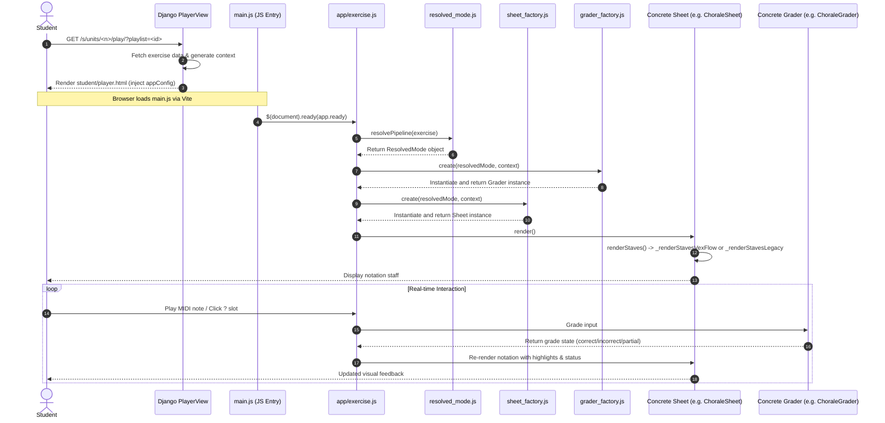

# Exercise Pipeline Map

This document provides a comprehensive, human-readable architectural map of how HarmonyLab (Monteverdi) routes, boots, renders, and grades student exercises. It defines the relationships between frontend controllers, renderers, graders, and database schemas.

---

## 1. Student Exercise Boot Flow

The following sequence details the boot path from the initial Django request to the mounting of active frontend modules.

### Diagram: Boot, Render, and Grading Flow


### Flow Breakdown

1. **Django View Layer**: 
   - [PlayerView](file:///Users/adorman/Library/CloudStorage/Dropbox/Codebases/HarmonyLab-1/apps/student/views.py#L921) handles requests for `s/units/<n>/play/`. 
   - It fetches the active `Exercise` database row and calls [generate_exercise_context](file:///Users/adorman/Library/CloudStorage/Dropbox/Codebases/HarmonyLab-1/apps/student/views.py#L985).
   - If the exercise type is out-of-scope for the main RequireJS player (specifically `umto_symbolic_meter` or `umto_barline_placement`), it renders the standalone [qa_player.html](file:///Users/adorman/Library/CloudStorage/Dropbox/Codebases/HarmonyLab-1/lab/templates/qa_player.html) template. Otherwise, it renders [student/player.html](file:///Users/adorman/Library/CloudStorage/Dropbox/Codebases/HarmonyLab-1/apps/student/templates/student/player.html).
2. **Template Layer**:
   - `apps/student/templates/student/player.html` writes the RequireJS-shaped config object into `window.appConfig`:
     `window.appConfig = {{ requirejs.config_json }};`
   - `apps/student/views.py` sets:
     - `app_module = "app/components/app/exercise"` via `rj_context.set_app_module(...)`
     - the exercise payload via `rj_context.set_module_params("app/components/app/exercise", exercise_context)`
   - The template loads the Vite entry point with:
     ``
3. **JS Module Bootstrap**:
   - `main.js` reads `window.appConfig.config["app/main"].app_module`, selects `ExerciseApp` (imported from `app/components/app/exercise.js`), and calls `app.ready` on document ready.
4. **App Initialization**:
   - `app/exercise.js` reads the exercise payload through `getModuleConfig("app/components/app/exercise")` (defined in [module_config.js](file:///Users/adorman/Library/CloudStorage/Dropbox/Codebases/HarmonyLab-1/lab/static/js/src/utils/module_config.js)).
   - `AppExerciseComponent` instantiates [ExerciseDefinition](file:///Users/adorman/Library/CloudStorage/Dropbox/Codebases/HarmonyLab-1/lab/static/js/src/models/exercise_definition.js) to wrap and parse the configuration payload.
   - It invokes [resolvePipeline](file:///Users/adorman/Library/CloudStorage/Dropbox/Codebases/HarmonyLab-1/lab/static/js/src/models/resolved_mode.js#L77) to extract a frozen `ResolvedMode` layout/grading classification.
   - It creates the [ExerciseChordBank](file:///Users/adorman/Library/CloudStorage/Dropbox/Codebases/HarmonyLab-1/lab/static/js/src/models/exercise_chord_bank.js) (as `models.inputChords`) to track real-time note inputs.
5. **Grader and Sheet Factories**:
   - `AppExerciseComponent` passes `ResolvedMode` to [GraderFactory.create](file:///Users/adorman/Library/CloudStorage/Dropbox/Codebases/HarmonyLab-1/lab/static/js/src/models/grader_factory.js#L185) to resolve the active grader key and return a grader instance (e.g. `ChoraleGrader` or `IdentificationGrader`). 
   - It constructs [ExerciseContext](file:///Users/adorman/Library/CloudStorage/Dropbox/Codebases/HarmonyLab-1/lab/static/js/src/models/exercise_context.js) which binds the grader, input chord bank, definition, and scorecard.
   - It passes `ResolvedMode` to [SheetFactory.create](file:///Users/adorman/Library/CloudStorage/Dropbox/Codebases/HarmonyLab-1/lab/static/js/src/models/sheet_factory.js#L109) to instantiate the target exercise sheet class (e.g. `ChoraleSheet`, `HarmonizationSheet`, `MatchingSheet`).

---

## 2. Pipeline Classification (`ResolvedMode`)

The authoritative pipeline discriminator is `lab/static/js/src/models/resolved_mode.js`. All checks for delivery/interaction style must read from its returned payload.

### Diagram: Pipeline Selection Decision Map
```mermaid
graph TD
    Start[Parsed Exercise Definition Data] --> Mode{Has exercise.mode?}
    Mode -->|Yes| ModeVal[mode = exercise.mode]
    Mode -->|No| UMToMeta{Has score.umto.metadata.mode?}
    UMToMeta -->|Yes| ModeVal[mode = score.umto.metadata.mode]
    UMToMeta -->|No| ModeVal[mode = null]
    
    ModeVal --> TypeCheck[Check type & mode]
    
    TypeCheck --> Symbolic{type === "umto_symbolic_meter"?}
    Symbolic -->|Yes| POther["other" pipeline]
    Symbolic -->|No| ChoraleId{type === "chorale_identification" OR<br>type === "umto_chorale" AND mode IN ["identification", "chorale_identification"]?}
    
    ChoraleId -->|Yes| PChoraleId["chorale_identification" pipeline]
    ChoraleId -->|No| Harm{mode === "harmonization"?}
    
    Harm -->|Yes| PHarm["harmonization" pipeline]
    Harm -->|No| Chorale{mode IN CHORALE_MODES?<br>or (mode === null AND type IN ["chorale", "umto_chorale"])?}
    
    Chorale -->|Yes| PChorale["chorale" pipeline]
    Chorale -->|No| Matching{type === "matching"?}
    
    Matching -->|Yes| PMatching["matching" pipeline]
    Matching -->|No| FB{type IN ["figured_bass", "figured_bass_pcs"]?}
    
    FB -->|Yes| PFB["figured_bass" pipeline]
    FB -->|No| Ident{type === "identification"?}
    
    Ident -->|Yes| PIdent["identification" pipeline]
    Ident -->|No| POther["other" pipeline]

    POther -->|Bypasses standard sheets| QAPlayer[SymbolicQuestionSheet / KeySigExercise / qa_player.html]
    PChoraleId -->|VexFlow stack| ChoraleIdSheet[ChoraleIdentificationSheet / IdentificationGrader]
    PHarm -->|VexFlow stack| HarmSheet[HarmonizationSheet / HarmonizationRuntimeGrader]
    PChorale -->|VexFlow stack| ChoraleSheet[ChoraleSheet / ChoraleGrader]
    PMatching -->|Legacy-stave stack| MatchSheet[MatchingSheet / ExerciseGrader]
    PFB -->|Legacy-stave stack| FBSD[FiguredBassSheet / ExerciseGrader]
    PIdent -->|Legacy-stave stack| IdentSheet[IdentificationSheet / IdentificationGrader]
```

### Resolver Rules and Traps
- **Fields Evaluated**: `exercise.type`, `exercise.mode` (derived via `resolveMode(exercise)`), `exercise.analysisType`, `exercise.staffDistribution`.
- **Resulting Fields**:
  - `pipeline`: String mapped to one of the six student pipelines (`matching`, `chorale`, `harmonization`, `figured_bass`, `identification`, `chorale_identification`) or `other`.
  - `stack`: `"vexflow"` (for chorale-like renders) or `"legacy-stave"`.
  - Predicate flags: `isChorale`, `isChoraleIdentification`, `isHarmonization`, `isAnalysisMatch`, `isIdentification`, `isSymbolicMeter`.
- **Trap 1 (`umto_chorale` + `mode="play"`)**: Once `exercise.mode` is evaluated as the truthy string `"play"`, `isChorale` returns `false` (since `"play"` is not in `CHORALE_MODES`). The type check fallback is skipped. It resolves to pipeline `"other"`, falling back to the legacy-stave stack and `ExerciseGrader`. This affects 9 dev-only database rows.
- **Trap 2 (`mode="chorale_identification"` literal)**: `umto_chorale` + `mode="chorale_identification"` literal resolves to the `"chorale_identification"` pipeline, but `app/exercise.js`'s grader-selection logic fails to route it to `IdentificationGrader` because it checks `interactionMode === "identification"` exactly. It falls back to `ExerciseGrader`. Confirmed NOT live in database content (0 rows).
- **Trap 3 (Out-of-Scope UMTO Types)**: `umto_symbolic_meter`, `umto_barline_placement`, `umto_key_signature`, and `umto_identification` resolve to `"other"`. They bypass standard RequireJS play workflows.

---

## 3. Per-Pipeline Behavior Matrix

| Pipeline / Exercise Family | Example Type & Mode | Resolved Mode Pipeline | Render Stack / Sheet Class | Grader Class / Grading Path | Input Method | State Owner | Submit / Advance Behavior | Known Issues / Caveats | Primary Files to Inspect |
|---|---|---|---|---|---|---|---|---|---|
| **Chorale Playback** | `umto_chorale` + `playback` | `chorale` | VexFlow / [ChoraleSheet](file:///Users/adorman/Library/CloudStorage/Dropbox/Codebases/HarmonyLab-1/lab/static/js/src/components/music/chorale_sheet.js) | [ChoraleGrader](file:///Users/adorman/Library/CloudStorage/Dropbox/Codebases/HarmonyLab-1/lab/static/js/src/models/chorale_grader.js) | MIDI / Virtual Piano | `ChoraleGrader` (`playedNoteIds`, `pointer`) | Auto-advances window-by-window. Saves progress to localStorage. Submits on completion. | `mode="play"` bug; planned `hand_mode` is unimplemented. | `chorale_sheet.js`, `chorale_grader.js`, `score_timeline.js` |
| **Chorale Analysis Match** | `umto_chorale` + `analysis_match` | `chorale` | VexFlow / `ChoraleSheet` | `ChoraleGrader` | MIDI / Virtual Piano | `ChoraleGrader` | Auto-advances window-by-window. Displays analysis overlays (e.g. note names). | Same as above. | Same as above; `exercise_sheet_playback.js` |
| **Chorale Identification** | `umto_chorale` + `identification` | `chorale_identification` | VexFlow / [ChoraleIdentificationSheet](file:///Users/adorman/Library/CloudStorage/Dropbox/Codebases/HarmonyLab-1/lab/static/js/src/components/music/chorale_identification_sheet.js) | [IdentificationGrader](file:///Users/adorman/Library/CloudStorage/Dropbox/Codebases/HarmonyLab-1/lab/static/js/src/models/identification_grader.js) | Click ? slots / dropdown / QWERTY text | `IdentificationGrader` (`answers`) & `ExerciseContext` (`_identPage`) | Page-by-page (default 4 columns). Navigates with Next/Prev. LocalStorage saves. Submits on check. | `mode="chorale_identification"` literal mismatch. | `chorale_identification_sheet.js`, `identification_grader.js`, `exercise_sheet_identification.js` |
| **Harmonization** | `umto_chorale` + `harmonization` | `harmonization` | VexFlow / [HarmonizationSheet](file:///Users/adorman/Library/CloudStorage/Dropbox/Codebases/HarmonyLab-1/lab/static/js/src/components/music/harmonization_sheet.js) | [HarmonizationRuntimeGrader](file:///Users/adorman/Library/CloudStorage/Dropbox/Codebases/HarmonyLab-1/lab/static/js/src/models/harmonization_runtime_grader.js) | MIDI / Virtual Piano | `ExerciseContext` (`_harmonizationPointer`, `acceptedHarmonizationSonorities`) | Slice-by-slice auto-advance on correct chord. Review mode loads template payload. | Realization spelling issues; `HarmonizationGrader` is dead code. | `harmonization_sheet.js`, `harmonization_runtime_grader.js`, `harmonization_grader_logic.js` |
| **Legacy Identification** | `identification` + `practice`/`submit` | `identification` | Legacy Stave / [IdentificationSheet](file:///Users/adorman/Library/CloudStorage/Dropbox/Codebases/HarmonyLab-1/lab/static/js/src/components/music/identification_sheet.js) | `IdentificationGrader` | Click ? slots / dropdown | `IdentificationGrader` | Non-paged vertical slot check. User clicks submit button to check. | **Major bug**: Question dropdown overlay does not mount (answers endpoint is empty `[]`). | `identification_sheet.js`, `exercise_sheet_identification_logic.js` |
| **Symbolic Meter** | `umto_symbolic_meter` | `other` | Standalone / [SymbolicQuestionSheet](file:///Users/adorman/Library/CloudStorage/Dropbox/Codebases/HarmonyLab-1/lab/static/js/src/components/music/symbolic_question_sheet.js) | Custom / Bypassed (retains `ExerciseGrader`) | Choice buttons / text | `SymbolicQuestionSheet` | Bypasses standard sheet factory and RequireJS app bootstrap. Renders in `qa_player.html`. | None documented. | `symbolic_question_sheet.js`, `app/exercise.js` |
| **Key Signature** | `umto_key_signature` | `other` | Bypassed / Custom staff | Custom Choice / [KeySigExercise](file:///Users/adorman/Library/CloudStorage/Dropbox/Codebases/HarmonyLab-1/lab/static/js/src/models/key_sig_exercise.js) | Choice buttons | `KeySigExercise` | Custom complete/submit callback. | Out of scope for RequireJS play app. Renders in `qa_player.html`. | `key_sig_exercise.js`, `app/exercise.js` |
| **Barline Placement** | `umto_barline_placement` | `other` | Bypassed / SVG Canvas | Custom | Mouse click | Template / Custom module | Submits on placement verification. | Renders strictly inside `qa_player.html`. | `apps/student/views.py`, `qa_player.html` |
| **Matching / Figured Bass** | `matching` or `figured_bass` | `matching` or `figured_bass` | Legacy Stave / [MatchingSheet](file:///Users/adorman/Library/CloudStorage/Dropbox/Codebases/HarmonyLab-1/lab/static/js/src/components/music/matching_sheet.js) or [FiguredBassSheet](file:///Users/adorman/Library/CloudStorage/Dropbox/Codebases/HarmonyLab-1/lab/static/js/src/components/music/figured_bass_sheet.js) | [ExerciseGrader](file:///Users/adorman/Library/CloudStorage/Dropbox/Codebases/HarmonyLab-1/lab/static/js/src/models/exercise_grader.js) (`legacy_exercise`) | MIDI / Virtual Piano | `ExerciseGrader` | Exact pitch matching or figure realization matching. | Legacy paths are frozen. 0 live database rows in student delivery. | `matching_sheet.js`, `figured_bass_sheet.js`, `exercise_grader.js` |

---

## 4. Rendering Architecture

HarmonyLab splits rendering into two separate stacks: **VexFlow (Measure-based)** and **Legacy Stave (Chord-based)**.

- **Class Selection**: Instantiation is managed entirely by [SheetFactory](file:///Users/adorman/Library/CloudStorage/Dropbox/Codebases/HarmonyLab-1/lab/static/js/src/models/sheet_factory.js) based on the `ResolvedMode` pipeline. The factory relies on constructor injection to bypass NodeJS import restrictions during standalone test execution.
- **Base Authority**: [BaseExerciseSheet](file:///Users/adorman/Library/CloudStorage/Dropbox/Codebases/HarmonyLab-1/lab/static/js/src/components/music/base_exercise_sheet.js) provides the core framework. Per-pipeline sheets (e.g. `ChoraleSheet`, `MatchingSheet`) inherit from it and override `renderStaves()`.
- **Render Stack Invocation**:
  - **VexFlow Stack**: `ChoraleSheet`, `HarmonizationSheet`, and `ChoraleIdentificationSheet` call the mixin method `_renderStavesVexFlow(midi_nums, cfg)` (from [exercise_sheet_staves.js](file:///Users/adorman/Library/CloudStorage/Dropbox/Codebases/HarmonyLab-1/lab/static/js/src/components/music/exercise_sheet_staves.js#L47)). Renders measures and systems using [VexFlowAdapter](file:///Users/adorman/Library/CloudStorage/Dropbox/Codebases/HarmonyLab-1/lab/static/js/src/components/music/rendering/vexflow_adapter.js).
  - **Legacy Stave Stack**: `MatchingSheet`, `FiguredBassSheet`, and `IdentificationSheet` call the mixin method `_renderStavesLegacy(midi_nums)` (from `exercise_sheet_staves.js`). Draws chords using [Stave](file:///Users/adorman/Library/CloudStorage/Dropbox/Codebases/HarmonyLab-1/lab/static/js/src/components/music/stave.js) and [StaveNoteFactory](file:///Users/adorman/Library/CloudStorage/Dropbox/Codebases/HarmonyLab-1/lab/static/js/src/components/music/stave_note_factory.js).
- **Factory Bypasses**:
  - `SymbolicQuestionSheet` and the `KeySigExercise` layout are instantiated directly in `app/exercise.js` rather than routing through the standard `SheetFactory`.
- **Module Responsibilities**:
  - **Playback Highlight**: Managed by [ExerciseSheetPlayback](file:///Users/adorman/Library/CloudStorage/Dropbox/Codebases/HarmonyLab-1/lab/static/js/src/components/music/exercise_sheet_playback.js).
  - **Status Output**: Managed by [ExerciseSheetStatus](file:///Users/adorman/Library/CloudStorage/Dropbox/Codebases/HarmonyLab-1/lab/static/js/src/components/music/exercise_sheet_status.js).
  - **Identification Overlay**: Input controls, QWERTY typing, dropdown choices, and canvas bounds are handled by [ExerciseSheetIdentification](file:///Users/adorman/Library/CloudStorage/Dropbox/Codebases/HarmonyLab-1/lab/static/js/src/components/music/exercise_sheet_identification.js) and its peer files.

---

## 5. Grading Architecture

Monteverdi uses a split grading engine where modern workflows are isolated into specific grader classes.

```
                  ┌─────────────────┐
                  │  GraderFactory  │
                  └────────┬────────┘
                           │
        ┌──────────────────┼─────────────────┐
        ▼                  ▼                 ▼
 ┌─────────────┐   ┌──────────────┐   ┌───────────────┐
 │ChoraleGrader│   │Ident. Grader │   │Legacy Grader  │
 └─────────────┘   └──────────────┘   │(ExerciseGrader│
                                      └───────────────┘
```

- **GraderFactory Keys**:
  - `"chorale"`: Instantiates `ChoraleGrader` for live scale and chorale playback/analysis drills.
  - `"identification"`: Instantiates `IdentificationGrader` (used for both static and paged identification tasks).
  - `"harmonization"`: Instantiates `HarmonizationGrader` (infrastructure only, not wired in production runtime).
  - `"legacy_exercise"`: Returns a "not wired" error. The app falls back to constructing `ExerciseGrader` directly in the `else` block of `app/exercise.js`.
- **Chorale Playback Engine**: [ChoraleGrader](file:///Users/adorman/Library/CloudStorage/Dropbox/Codebases/HarmonyLab-1/lab/static/js/src/models/chorale_grader.js) builds an onset-window map using [ScoreTimeline](file:///Users/adorman/Library/CloudStorage/Dropbox/Codebases/HarmonyLab-1/lab/static/js/src/components/music/score_timeline.js). Tracks attacks/releases within small timing tolerances (pedagogically forgiving).
- **Identification Engine**: [IdentificationGrader](file:///Users/adorman/Library/CloudStorage/Dropbox/Codebases/HarmonyLab-1/lab/static/js/src/models/identification_grader.js) records answer selections by slot index, matches them against `problem.answer` entries, and reports correct counts. Exposes absolute page-index mappings for pagination.
- **Legacy Fallback**: [ExerciseGrader](file:///Users/adorman/Library/CloudStorage/Dropbox/Codebases/HarmonyLab-1/lab/static/js/src/models/exercise_grader.js) is preserved as a single fallback class. Attempts to split its internal types (`notesMatch`, `figuredBassMatch`, `analysisMatch`) into independent classes were paused because those legacy paths contain zero live student database rows.
- **Harmonization Live Grading**: This path is completely separate from `ExerciseGrader` and `GraderFactory`. Real-time harmonization checks are managed directly by [HarmonizationRuntimeGrader](file:///Users/adorman/Library/CloudStorage/Dropbox/Codebases/HarmonyLab-1/lab/static/js/src/models/harmonization_runtime_grader.js) via `ExerciseContext.computeHarmonizationGraded(activeMidi)`. It executes slice-by-slice validation checks (locked bass, allowed note pitches, required pitch-class fulfillment) and mutates tracking states on the context.

---

## 6. Runtime Interaction & State Ownership

Interaction state is carefully divided between context classes, grader instances, and browser storage:

- **Sounding MIDI Inputs**: Tracked in `inputChords` (instance of `ExerciseChordBank`) owned by `AppExerciseComponent`.
- **Harmonization REALIZATION State**: Owned and mutated directly on `ExerciseContext` (not the grader or input banks):
  - `ctx._harmonizationPointer` (index of the active chord slice to realize).
  - `ctx.acceptedHarmonizationSonorities` (array of `{ midi, targetIndex, ts }` representing correct/partial realization slices completed).
  - `ctx._harmonizationRejected` (holds the most recent failed chord's midi numbers, measure details, and fail reasons).
- **Identification Selections**: Stored on `IdentificationGrader.answers` as `{ absoluteProblemIndex: selectedAnswerString }`. Paging states (`_identPage`, `_identPageSize`) live on `ExerciseContext`.
- **Chorale Performance state**: `ChoraleGrader.playedNoteIds` (Set of note timeline IDs successfully played) and `ChoraleGrader.pointer` (current timeline onset index).
- **LocalStorage State Persistence**:
  - **Identification**: Saved via `saveIdentState(exerciseId)` under key `"identAnswers:<exerciseId>"`. Restored via `restoreIdentState` on load. Cleared on successful grading submission.
  - **Chorale**: Saved via `saveChoraleState(exerciseId)` under key `"choraleState:<exerciseId>"`. Restored via `restoreChoraleState`. Wiped if older than 7 days.
  - **Harmonization**: Bypasses local storage. Review/restore displays are populated using the server-injected `reviewHarmonizationSonorities` payload on load.

---

## 7. Known Divergences & Bugs

1. **`umto_chorale` + `mode="play"` (Dev-Only)**: Resolves to pipeline `"other"`, triggering a legacy-stave matching layout instead of VexFlow playback. Exists in 9 dev-only database rows.
2. **`mode="chorale_identification"` Literal**: Mismatches the grader-selection checks in `app/exercise.js`, causing the app to fall back to `ExerciseGrader`. This scenario affects 0 rows in active data.
3. **`type="identification"` Blank Dropdown Bug**: Legacy identification question panels load, but the dropdown choices and `?` slots do not mount because the API endpoint `/ajax/identification-answers/?exercise_id=<id>` returns an empty list (`[]`).
4. **`run_js_tests.sh` Alias Wall**: Standalone NodeJS test execution fails if a file statically imports a module with a webpack alias (e.g. `app/components/music/score_timeline` in `chorale_grader.js`). Resolved in `grader_factory.test.js` and `sheet_factory.test.js` by injecting mock constructors.

---

## 8. For Agents / Codegraph Reference

When working inside Monteverdi's exercise pipeline, follow these rules to avoid regression and maintain architectural integrity.

### Canonical Files to Inspect First
1. `lab/static/js/src/models/resolved_mode.js` (Pipeline resolver)
2. `lab/static/js/src/models/sheet_factory.js` (Sheet generator)
3. `lab/static/js/src/models/grader_factory.js` (Grader generator)
4. `lab/static/js/src/components/music/base_exercise_sheet.js` (Base sheet class)
5. `lab/static/js/src/models/harmonization_runtime_grader.js` (Harmonization grader)

### Forbidden Shortcuts
- **No Raw Comparisons**: Never write comparisons against `exercise.type`, `exercise.mode`, `exercise.analysisType`, or `staffDistribution` directly in component view or layout files. Always route your query through `ResolvedMode` fields.
- **No CJS in Browser**: Do not write `require()` or `module.exports` inside files served to the browser (`lab/static/js/src/**`). They must be native ESM. Custom ESLint rules check this (`npm run lint`).
- **No Grader Bloat**: Do not add new grading logic to `ExerciseGrader.js`. That file is a frozen legacy fallback class.

### Misleading Grep Patterns
- `grep "isChorale()"`: This is a legacy method on `ExerciseDefinition`. It does not match modern pipeline boundaries. Look for `ResolvedMode` fields instead.
- `grep "HarmonizationGrader"`: This returns the inactive `harmonization_grader.js` wrapper. The active, live runtime grader is `HarmonizationRuntimeGrader` (`harmonization_runtime_grader.js`).

### How to Add a New Exercise Type Safely
1. Update `lab/static/js/src/models/resolved_mode.js` to register the new pipeline classification.
2. Add a classification case to `lab/static/js/src/models/resolved_mode.test.js`.
3. Create a per-pipeline sheet subclass under `lab/static/js/src/components/music/` and register it in `models/sheet_factory.js`. Add matching tests in `models/sheet_factory.test.js`.
4. If a new grading path is required, register the key in `models/grader_factory.js` and add matching tests in `models/grader_factory.test.js`.
5. Run the local architecture validation command:
   ```bash
   npm run check:pipeline-architecture
   ```
6. Complete updates to documentation:
   - Add/verify a summary row in `docs/exercise_types.md`.
   - Update `docs/architecture/pipeline-registry.md` to register your new files under their respective pipeline tag.
