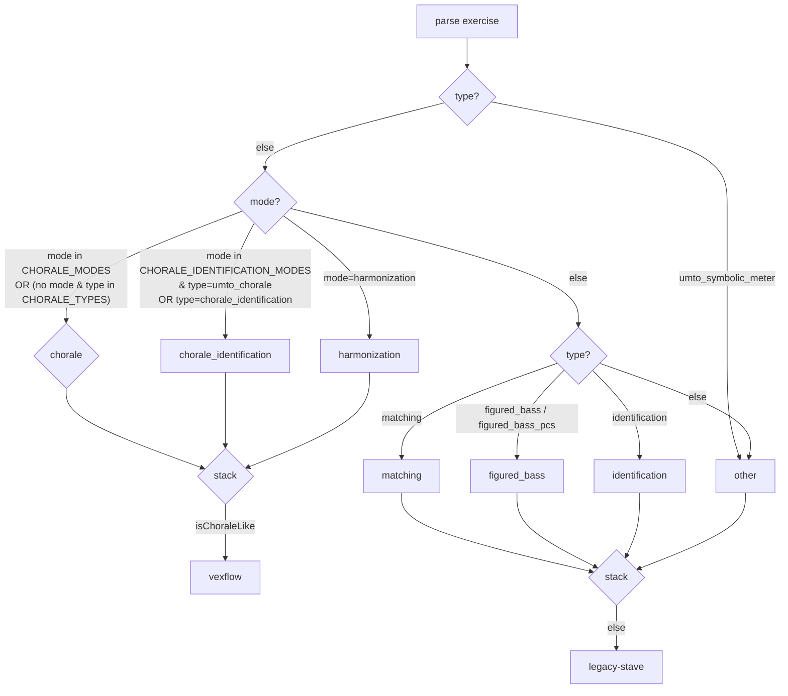
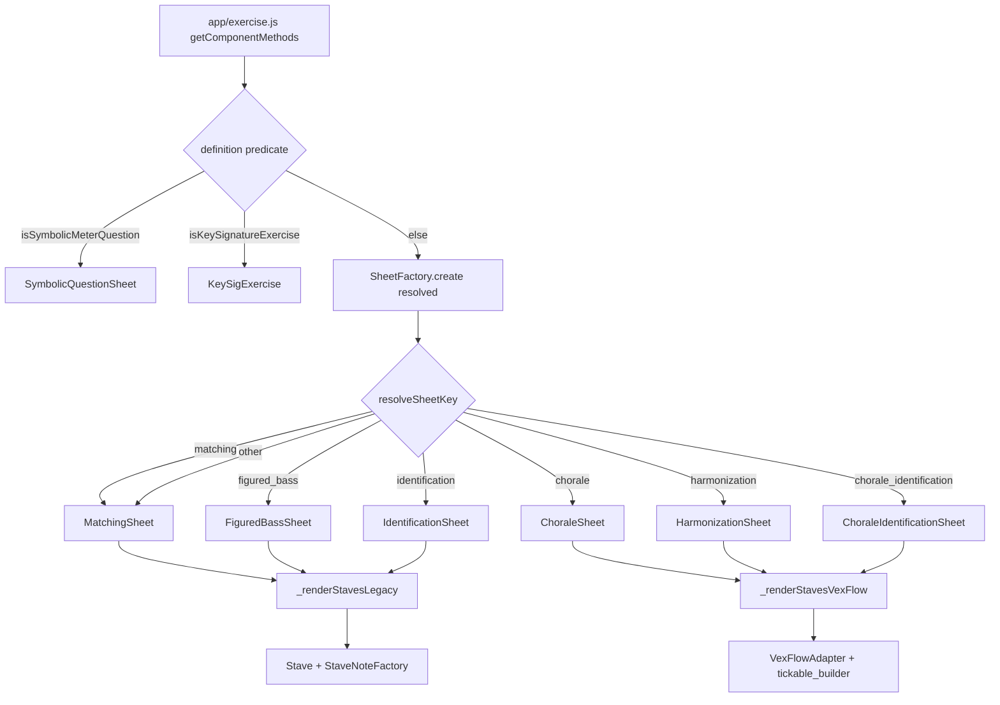

# Exercise Pipeline Map

A human-readable map of how Monteverdi/HarmonyLab delivers, renders, and grades
student exercises **after the Phase 0–5 pipeline refactor**. For the
file-by-file owner map see
[docs/architecture/pipeline-registry.md](pipeline-registry.md); for the locked
architecture statement see
[docs/architecture/exercise-pipeline-architecture.md](exercise-pipeline-architecture.md).
To add a new exercise type, follow
[docs/architecture/new-exercise-type-checklist.md](new-exercise-type-checklist.md).

This document is for humans first. Every claim below was verified by reading the
current code (2026-07-06). Items not directly verified are marked
**unverified**.

---

## 1. Student exercise boot flow

One URL serves every student exercise: `s/units/<n>/play/`. Pipeline selection
is **data-driven** (fields on the exercise payload), never URL-driven.

| Step | File | What happens |
|---|---|---|
| Route | `apps/student/urls.py` | `units/<str:unit_num>/play/` → `student:PlayerView` |
| View | `apps/student/views.py` `PlayerView` (`get`, ~L1080–1151) | Builds `exercise_context` (server-side), then chooses template |
| Template fork | `apps/student/views.py:1105` | `type` in `{umto_symbolic_meter, umto_barline_placement}` → `qa_player.html` (separate QA player, not the 6-pipeline path). Else → `student/player.html` |
| RequireJS context | `apps/student/views.py:1123–1125` | `rj_context.set_app_module("app/components/app/exercise")` + `set_module_params("app/components/app/exercise", exercise_context)` — injects the per-exercise config payload |
| Template | `apps/student/templates/student/player.html` | RequireJS entry template |
| Bootstrapper | `lab/static/js/src/main.js` | Reads `window.appConfig.config['app/main'].app_module`, maps to `ExerciseApp`, runs `$(document).ready(app.ready)` |
| App module | `lab/static/js/src/components/app/exercise.js` | `AppExerciseComponent.ready` → `new AppExerciseComponent().init()` |
| Definition | `lab/static/js/src/models/exercise_definition.js` | `new ExerciseDefinition({definition})` parses the payload and caches `this._resolved = resolvePipeline(this.exercise)` |
| Resolver | `lab/static/js/src/models/resolved_mode.js` | `resolvePipeline(exercise)` → frozen `ResolvedMode` (see §2) |
| Grader | `lab/static/js/src/models/grader_factory.js` + `app/exercise.js` `getModels()` | 3-way branch; `chorale` + `identification` branches route through `GraderFactory.create()` (guarded); `else` constructs `ExerciseGrader` directly |
| Sheet | `lab/static/js/src/models/sheet_factory.js` + `app/exercise.js` `getComponentMethods()` | `createSheet(resolved, {...constructors})` — single unconditional instantiation; symbolic-meter / key-signature early-return first |
| Context | `lab/static/js/src/models/exercise_context.js` | `new ExerciseContext({inputChords, grader, definition, exercise, scoreCard})` — owns runtime state, grading dispatch, submit |

`getExerciseDefinition()` (`app/exercise.js:301`) reads the payload via
`getModuleConfig("app/components/app/exercise")` — that is the
`set_module_params` value the view injected. `getModels()`
(`app/exercise.js:92`) wires `ExerciseDefinition`, `ExerciseChordBank`
(`inputChords`), the grader, `ExerciseScoreCard`, and `ExerciseContext`.

---

## 2. Pipeline classification (`ResolvedMode`)

`lab/static/js/src/models/resolved_mode.js` `resolvePipeline(exercise)` is the
**only** pipeline classifier. Input is the **parsed** exercise object
(`ExerciseDefinition.prototype.exercise`), not the raw config.

**Raw fields read:**

| Field | Source | Used for |
|---|---|---|
| `type` | `exercise.type` | pipeline + identification + symbolic-meter |
| `mode` | `exercise.mode` ‖ `exercise.score.umto.metadata.mode` (via `resolveMode`) | chorale / harmonization / identification mode gate |
| `analysisType` | `exercise.analysisType` | exposed as `analysisKind` |
| `staffDistribution` | `exercise.staffDistribution` | exposed as `staffStyle` (layout axis, not pipeline) |

**Resulting fields** (frozen): `pipeline`, `exerciseType`, `interactionMode`,
`analysisKind`, `staffStyle`, `stack`, `isChorale`, `isChoraleIdentification`,
`isHarmonization`, `isAnalysisMatch`, `isIdentification`, `isSymbolicMeter`.

**Pipeline derivation order** (matters — `chorale_identification` and
`harmonization` are subsets of `isChorale`):

Constant sets:

- `CHORALE_MODES = ["playback", "analysis_match", "play-all-voices", "analysis"]`
- `CHORALE_IDENTIFICATION_MODES = ["identification", "chorale_identification"]`
- `CHORALE_TYPES = ["chorale", "umto_chorale"]`
- `FIGURED_BASS_TYPES = ["figured_bass", "figured_bass_pcs"]`

`stack`: `isChoraleLike = isChorale || isChoraleIdentification || isHarmonization`
→ `"vexflow"`; else `"legacy-stave"`.

**Known traps:**

- **`umto_chorale + mode="play"` → `other`/legacy-stave.** `parse()`
  default-fills `exercise.mode = "play"` (`exercise_definition.js:893`). Once
  mode is truthy, `isChorale()` runs the mode check first; `"play"` ∉
  `CHORALE_MODES`, so `isChorale` is false and the type-fallback never runs.
  9 persisted rows carry `type=umto_chorale AND mode="play"` (dev/factory-seed,
  not live student content). The resolver mirrors this faithfully — do NOT
  "fix" it without a decision + DB audit + snapshot.
- **`mode="chorale_identification"` literal on `umto_chorale`.** `GraderFactory`
  maps `chorale_identification` → `identification` (predicate intent), but the
  production `app/exercise.js` branch requires `interactionMode === "identification"`
  exactly, so the literal falls through to `ExerciseGrader`. **0 rows.** Not
  live; mapping kept as a guard against future data.
- **Out-of-scope UMTO types** — `umto_symbolic_meter`, `umto_key_signature`,
  `umto_barline_placement`, `musicxml`, `analytical`, `analytical_pcs`,
  `umto_identification` → `resolvePipeline` returns `"other"`. Symbolic-meter
  and key-signature are intercepted by early-returns in `app/exercise.js`
  before the factories; the rest render through the legacy-stave fall-through
  (no identification overlay), graded via `ExerciseGrader`.

---

## 3. Per-pipeline behavior table

| Pipeline | Example type/mode | `ResolvedMode.pipeline` | Render stack / sheet class | Grader class / path | Input method | State owner | Submit / advance | Known issues / caveats | Primary files |
|---|---|---|---|---|---|---|---|---|---|
| Chorale playback | `umto_chorale` + `playback` | `chorale` | VexFlow / `ChoraleSheet` | `ChoraleGrader` (via `GraderFactory.create` guarded) | MIDI / held-note timeline | `ChoraleGrader` timeline + `ExerciseContext` chorale state (localStorage restore) | onset-window match advances position | `isChoralePlay` gate keeps raw `definition.mode === "playback"` (Phase 1.3 exemption) | `components/app/exercise.js`, `models/chorale_grader.js`, `components/music/chorale_sheet.js` |
| Chorale analysis_match | `umto_chorale` + `analysis_match` | `chorale` | VexFlow / `ChoraleSheet` (`isAnalysisMatchMode: true`) | `ChoraleGrader` | MIDI | `ChoraleGrader` | same | `ChoraleSheet` reads `resolved.isAnalysisMatch` (only flag varying within chorale) | same + `resolved_mode.js` |
| Chorale identification | `umto_chorale` + `identification`, or `type=chorale_identification` | `chorale_identification` | VexFlow / `ChoraleIdentificationSheet` (`isChoraleIdentification: true`) | `IdentificationGrader` (via factory when `resolveGraderKey==="identification"`) | dropdown "?" slots | `IdentificationGrader.answers` + `restoreIdentState` localStorage | answer-slot submit | `mode="chorale_identification"` literal divergence (0 rows, guarded) | `models/identification_grader.js`, `components/music/chorale_identification_sheet.js` |
| Harmonization | `umto_chorale` + `harmonization` | `harmonization` | VexFlow / `HarmonizationSheet` (`isHarmonization: true`) | `ExerciseContext.computeHarmonizationGraded(activeMidi)` → `harmonization_runtime_grader.js` (NOT `GraderFactory`) | MIDI held-notes, one target at a time | `ExerciseContext` (`_harmonizationPointer`, `acceptedHarmonizationSonorities`, `_harmonizationRejected`) | per-target accept/reject advances pointer | Not wired through `GraderFactory`; `HarmonizationGrader`/`ExerciseGrader` harmonization switch case are dead code paths | `models/harmonization_runtime_grader.js`, `models/exercise_context.js`, `components/music/harmonization_sheet.js` |
| Legacy identification | `type=identification` (e.g. Unit 5 triad quality) | `identification` | Legacy stave / `IdentificationSheet` (+ ID overlay) | `IdentificationGrader` (via factory when key resolves) | dropdown / text | `IdentificationGrader.answers` | answer-slot submit | **Overlay does not render** — `/ajax/identification-answers/` returns `[]`; pre-existing, not a refactor regression | `components/music/identification_sheet.js`, `models/identification_grader.js` |
| Symbolic meter | `umto_symbolic_meter` | `other` (intercepted pre-factory) | `SymbolicQuestionSheet` (custom, not via `SheetFactory`) | QA-player path (`qa_player.html`) — **unverified** beyond template fork | dropdown / flashcard | `qa_player.js` reducer + `saveState` | `dispatch` SUBMIT_QUIZ / NEXT_PAGE | Separate template; not part of 6-pipeline split | `lab/static/js/src/qa_player.js`, `apps/student/templates/qa_player.html` |
| Key signature | `umto_key_signature` | `other` (intercepted pre-factory) | `KeySigExercise` (custom VexFlow, not via `SheetFactory`) | `KeySigExercise.submit` → patches `exc.grader.getScore` → `ExerciseContext.submitExerciseReport` | choice buttons | `KeySigExercise` instance | `onComplete` triggers grade + advance | Bypasses normal sheet/grader factories entirely | `models/key_sig_exercise.js`, `app/exercise.js:466–526` |
| Barline placement | `umto_barline_placement` | `other` | QA-player path (`qa_player.html`) — **unverified** | QA-player path — **unverified** | **unverified** | **unverified** | **unverified** | Largest exercise-type bucket (26,491 rows); routes to `qa_player.html`, not the student sheet path | `apps/student/templates/qa_player.html` |
| Matching | `type=matching` | `matching` | Legacy stave / `MatchingSheet` | `ExerciseGrader.notesMatch` (legacy fallback, not factory-wired) | note entry | `inputChords` + `ExerciseGrader` | exact-match submit | **0 rows in DB**; legacy shape frozen | `components/music/matching_sheet.js`, `models/exercise_grader.js` |
| Figured bass | `type=figured_bass` / `figured_bass_pcs` | `figured_bass` | Legacy stave / `FiguredBassSheet` (+ ID overlay) | `ExerciseGrader.figuredBassMatch` / `figuredBassPcsMatch` (legacy fallback) | dropdown / figured-bass slots | `inputChords` + `ExerciseGrader` | answer submit | **0 rows in DB**; legacy shape frozen | `components/music/figured_bass_sheet.js`, `config/figured_bass_hints*.js` |
| Other / fallback | any unrecognized | `other` | Legacy stave fall-through (`other`→`matching` sheet) | `ExerciseGrader` (constructed directly in `else` branch) | varies | `ExerciseGrader` | exact-match submit | Dev/factory-seed only for live rows | `models/grader_factory.js`, `models/exercise_grader.js` |

---

## 4. Rendering architecture

**Selection:** `lab/static/js/src/models/sheet_factory.js`
`resolveSheetKey(resolvedMode)` → `SHEET_KEYS[resolved.pipeline] || "matching"`.
`SHEET_KEYS` maps the 6 pipelines to themselves and `other → matching`.

**Base class:** `lab/static/js/src/components/music/base_exercise_sheet.js`
(`BaseExerciseSheet`) — god-class body moved here in Phase 3. Owns the two
stack methods:

- `_renderStavesVexFlow(exercise_midi_nums, cfg)` — VexFlow body; reads pipeline
  flags from `cfg` (caller-supplied).
- `_renderStavesLegacy(exercise_midi_nums)` — legacy `Stave` loop + identification
  label draw.

Per-pipeline subclasses override only `renderStaves` to call the right stack
method with their cfg:

| Sheet class | Stack | cfg |
|---|---|---|
| `matching_sheet.js` `MatchingSheet` | legacy | — |
| `figured_bass_sheet.js` `FiguredBassSheet` | legacy | + ID overlay (self-gated on base) |
| `identification_sheet.js` `IdentificationSheet` | legacy | + ID overlay |
| `chorale_sheet.js` `ChoraleSheet` | VexFlow | reads `resolved.isAnalysisMatch` + `resolved.isChorale` (only flags varying within chorale) |
| `harmonization_sheet.js` `HarmonizationSheet` | VexFlow | `isHarmonization: true` literal |
| `chorale_identification_sheet.js` `ChoraleIdentificationSheet` | VexFlow | `isChoraleIdentification: true` literal |

**VexFlow stack** (chorale / harmonization / chorale_identification):
`rendering/vexflow_adapter.js`, `vexflow_adapter_logic.js`,
`vexflow_tickable_builder.js`, `vexflow_render_config.js`,
`utils/umto_score_converter.js`.

**Legacy stave stack** (matching / figured_bass / identification):
`stave.js`, `stave_note_factory.js`, `exercise_note_factory.js`.

**Bypass the normal sheet factory** (intercepted before `SheetFactory` in
`app/exercise.js:456–526`):

- `SymbolicQuestionSheet` (`symbolic_question_sheet.js`) — `definition.isSymbolicMeterQuestion()`.
- `KeySigExercise` (`models/key_sig_exercise.js`) — `definition.isKeySignatureExercise()`.

**Playback / status / staves** live on mixins mixed onto `BaseExerciseSheet`:
`exercise_sheet_playback.js` (chorale), `exercise_sheet_status.js`,
`exercise_sheet_staves.js` (the two `_renderStaves*` methods), and the
`exercise_sheet_identification*.js` family (shared overlay for identification +
chorale_identification + figured_bass).

---

## 5. Grading architecture

**`GraderFactory` wired keys** (`lab/static/js/src/models/grader_factory.js`):

`GRADER_KEYS = { matching: legacy_exercise, chorale: chorale,
harmonization: harmonization, figured_bass: legacy_exercise,
identification: identification, chorale_identification: identification,
other: legacy_exercise }`.

`create()` constructs:
- `harmonization` → `new HarmonizationGrader(context)` (but **not the live
  path** — see below).
- `identification` → `new IdentificationGrader({})`.
- `chorale` → `resolveChoraleGraderSettings(definition)` + `new ChoraleGrader(settings)` + `initFromDefinition(definition)` (requires injected `context.constructors.ChoraleGrader`).
- `legacy_exercise` → **throws** (not wired).

**`app/exercise.js` 3-way selection** (conditions unchanged, construction routed
through factory where proven safe):

1. `interactionMode === "identification"` or (`!interactionMode` and
   `isIdentification || isChoraleIdentification`) → `IdentificationGrader`
   (factory when `resolveGraderKey==="identification"`, else direct). Then
   `initFromDefinition`.
2. `interactionMode === "playback" | "analysis_match"` or (`!interactionMode` and
   `isChorale`) → `ChoraleGrader` (factory when `resolveGraderKey==="chorale"`,
   else inline `new ChoraleGrader(getGrading())` + Unit-1 `octaveIndependent`
   override + `initFromDefinition`).
3. `else` → `new ExerciseGrader({keySignature})` (harmonization, matching,
   figured_bass, other all land here).

**ChoraleGrader path:** `lab/static/js/src/models/chorale_grader.js` —
onset-based MIDI timeline grading. Settings derived via
`chorale_grader_settings.js` (`resolveChoraleGraderSettings`).

**IdentificationGrader path:** `lab/static/js/src/models/identification_grader.js`
— same class for `identification` + `chorale_identification`, discriminated by
type/mode. `answers` populated from `reviewAnswers` or `restoreIdentState`.

**Retained `ExerciseGrader` fallback:** `lab/static/js/src/models/exercise_grader.js`
— god-class. Its per-type methods (`notesMatch`, `figuredBassMatch`,
`figuredBassPcsMatch`, `analysisMatch`, `analysisPcsMatch`) are **not exercised
by any reachable student content** (0 rows for matching/figured_bass/analytical;
only dev/factory-seed for odd-mode `umto_chorale`). The harmonization switch
case is dead in production. This is the retained legacy fallback — do **not**
add new grader logic here; route through `GraderFactory`.

**Harmonization live runtime path:** `ExerciseContext.computeHarmonizationGraded(activeMidi)`
(`exercise_context.js`) delegates to
`lab/static/js/src/models/harmonization_runtime_grader.js`
`computeHarmonizationGraded(ctx, activeMidi)`. Stateful, single-target-at-a-time
(via `_harmonizationPointer`). State stays on `ExerciseContext`. This is **not**
`GraderFactory`-wired and unrelated to `HarmonizationGrader`/`ExerciseGrader`.

**NOT yet split or wired:**

- `legacy_exercise` key throws in `GraderFactory.create()`; `ExerciseGrader` is
  still constructed directly in the `else` branch.
- `harmonization` key constructs `HarmonizationGrader` in the factory, but no
  production caller uses the factory for harmonization, and the live path is
  `computeHarmonizationGraded` regardless.
- `ExerciseGrader → LegacyExerciseGrader` rename deferred (Phase 2 open slice).

---

## 6. Runtime interaction / state ownership

| Family | State location | Restore path |
|---|---|---|
| Chorale playback / analysis_match | `ChoraleGrader` timeline + `ExerciseContext` chorale fields | `ExerciseContext.restoreChoraleState(exerciseId)` — localStorage (`app/exercise.js:282–288`) |
| Chorale identification / legacy identification | `IdentificationGrader.answers` | `restoreIdentState(exerciseId)` or `definition.reviewAnswers` clone (`app/exercise.js:253–259`) |
| Harmonization | `ExerciseContext._harmonizationPointer`, `acceptedHarmonizationSonorities`, `_harmonizationRejected` — read/written directly by 6 components (`components/music.js`, `input/click_note.js`, `exercise_sheet_playback.js`, `exercise_sheet_staves.js`, `exercise_sheet_status.js`, `app/exercise.js`) | review mode: clone `definition.reviewHarmonizationSonorities` + set `_reviewDisplayOnly` (`app/exercise.js:261–277`) |
| Matching / figured_bass / other | `inputChords` (`ExerciseChordBank`) + `ExerciseGrader` | none |
| Symbolic meter | `qa_player.js` reducer state | `saveState` (localStorage) — **unverified** |
| Key signature | `KeySigExercise` instance (`mistakes`, `index`) | none |

`inputChords` (`ExerciseChordBank`, `app/exercise.js:128`) is created with
`staffDistribution` and shared across MIDI/click input components and the sheet.

---

## 7. Known divergences and bugs

From the registry's "Known divergences + open questions" (2026-07-05/06):

1. **`umto_chorale + mode="play"` → `other`/legacy-stave** — 9 rows, dev/factory
   seed, not live. Resolver mirrors the latent bug faithfully; do not fix
   without a decision + DB audit + snapshot. (`resolved_mode.js` header NOTE.)
2. **`mode="chorale_identification"` literal on `umto_chorale`** — 0 rows.
   `GraderFactory` maps to `identification` (predicate intent); production
   `app/exercise.js` falls through to `ExerciseGrader`. Guard against future
   data. (`grader_factory.js` CAVEAT.)
3. **`type="umto_identification"`** — teacher-selectable, but
   `exercise_definition.js parse()` has no branch and no predicate recognizes
   it → `other`. 0 rows. Open Phase 1 question.
4. **`type=identification` overlay does not render** — legacy identification
   (e.g. `EB81WJ`, Unit 5 triad quality) routes correctly to the
   `identification` pipeline + legacy-stave, but the "?" overlay does not mount
   and `/ajax/identification-answers/?exercise_id=EB81WJ` returns `[]`. Confirmed
   pre-existing (identical on prod), not a Phase 3 regression. Deferred.
5. **`run_js_tests.sh` `app/`-alias failures** — 10-file baseline of
   pre-existing failures reproduced on `master` (e.g. `chorale_grader`,
   `vexflow_tickable_builder`, `play_save_logic`, `chorale_grader_settings`,
   `identification_mixin_manifest`, `theory_golden/figured_bass_hints`, …).
   NOT caused by this refactor. The focused gate `npm run test:pipeline`
   excludes these and is green.
6. **Odd-mode `umto_chorale` rows** (`play`/`identify`/`figures`/`roman`, 27
   rows) — same root cause as #1; dev/factory-seed only, not reachable via
   `/s/units/<n>/play/`.
7. **Not-live legacy paths** — `matching`, `figured_bass`, `figured_bass_pcs`,
   legacy `chorale`, `chorale_identification` (as a type), `analytical`,
   `analytical_pcs` all have **0 rows**. Frozen for new writes (AGENTS.md).

---

## 8. For agents / Codegraph

**Canonical files to read first:**

- `docs/architecture/pipeline-registry.md` — file-by-file owner map.
- `docs/architecture/exercise-pipeline-architecture.md` — locked statement.
- `docs/architecture/new-exercise-type-checklist.md` — add/modify pipeline.
- `lab/static/js/src/models/resolved_mode.js` — the only pipeline classifier.
- `lab/static/js/src/models/grader_factory.js`, `sheet_factory.js` — selection seams.
- `lab/static/js/src/components/app/exercise.js` — boot/wiring.
- `lab/static/js/src/models/exercise_context.js` — runtime state + harmonization path.

**Forbidden shortcuts:**

- Do not grep raw `type`/`mode`/`analysisType`/`staffDistribution` strings to
  route pipelines. Read `ResolvedMode`. The
  `harmonylab-pipelines/no-raw-pipeline-discriminator` ESLint rule enforces
  this (allowlist: `resolved_mode.js`, `grader_factory.js`,
  `exercise_definition.js`, `input_method_logic.js`,
  `harmonization_targets_logic.js`, `chord.js`,
  `chordal_umto_staff_distribution.js`, `**/*.test.js`; 3 inline exemptions in
  `app/exercise.js`, `exercise_sheet_identification_logic.js`,
  `stave_note_factory.js`).
- Do not add new grader logic to `ExerciseGrader`. Route through
  `GraderFactory`.
- Do not wire `harmonization` through `GraderFactory` without scoping a
  reconciliation with `computeHarmonizationGraded`'s stateful interface.
- Do not add CommonJS/RequireJS to `lab/static/js/src/**` (native ESM only;
  `harmonylab/no-cjs-in-browser` rule). Test files under `**/*.test.js` are
  exempt.
- Do not "fix" the documented divergences (§7) mid-refactor — each needs its
  own scoped decision + DB audit + characterization snapshot.

**Misleading grep patterns:**

- `"chorale"` matches three unrelated axes: `type` (pipeline), `mode`
  (`CHORALE_MODES`), and `staffDistribution` (`DISTRIBUTION_CHORALE`, a layout
  value, `forms.py:496`). `chord.js`/`stave_note_factory.js` reads of
  `staffDistribution === "chorale"` are layout, not pipeline.
- `VexFlowAdapter` imported in a file does not mean it draws notes there —
  `play_sheet.js` (teacher authoring) imports it but only calls `.render()` at
  two preview call sites (see [chorale-system.md](chorale-system.md)).
- `getMode()` / `isChorale()` outside `resolved_mode.js` /
  `exercise_definition.js` may be a stale predicate read. Prefer
  `definition.getResolvedMode()`.
- `isChoraleLike` no longer exists as a render fork — Phase 3 replaced it with
  per-pipeline sheet classes. Grepping for it will only find comments.

**How to add a new exercise type safely:**

1. UMTO only — create via `save_umto_exercise` or a sanctioned factory.
2. Add the type/mode to `resolvePipeline` (`resolved_mode.js`) + a
   `resolved_mode.test.js` characterization case.
3. If it needs a render sheet: add a per-pipeline sheet overriding only
   `renderStaves`, and map it in `SHEET_KEYS` + `sheet_factory.test.js`.
4. If it has a live grader: add a `GRADER_KEYS` entry + wire `create()` + a
   `grader_factory.test.js` case. Do NOT add to `ExerciseGrader`.
5. Native ESM only; no CJS in browser source.
6. Update `docs/exercise_types.md` + `pipeline-registry.md`.
7. Add a browser smoke case (rendering change) — real browser, not headless
   (`Tone.start()` audio gate blocks headless Chromium).
8. `npm run check:pipeline-architecture` green.

**Suggested codegraph queries / dependency-graph roots:**

- `codegraph_explore "resolvePipeline ResolvedMode"` — classifier.
- `codegraph_explore "GraderFactory create resolveGraderKey GRADER_KEYS"` — grader seam.
- `codegraph_explore "SheetFactory create resolveSheetKey SHEET_KEYS"` — sheet seam.
- `codegraph_explore "AppExerciseComponent getModels getComponentMethods"` — boot wiring.
- `codegraph_explore "ExerciseContext computeHarmonizationGraded HarmonizationRuntimeGrader"` — harmonization live path.
- `codegraph_explore "BaseExerciseSheet _renderStavesVexFlow _renderStavesLegacy"` — render stacks.

**Local gate:** `npm run check:pipeline-architecture` → `lint` → `build` →
`test:eslint-rules` → `test:pipeline`. No Node/JS CI exists today; this is the
required gate.