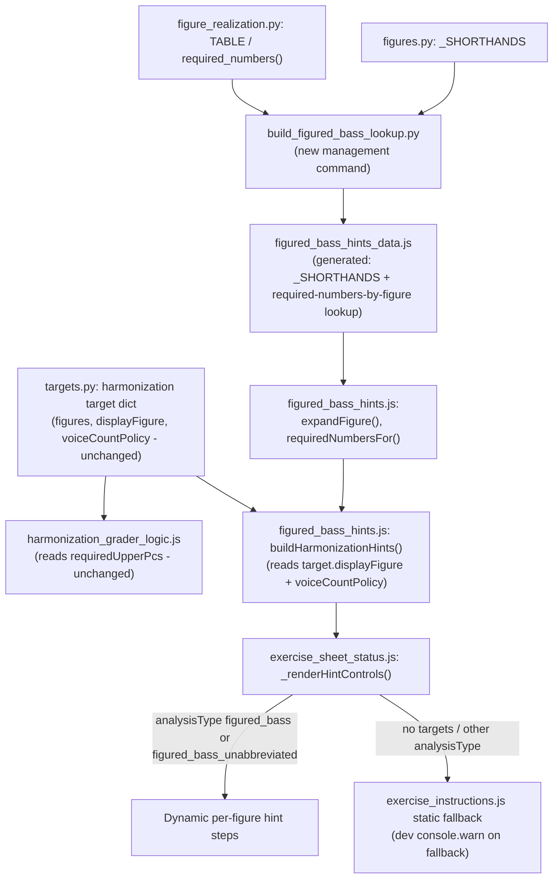

# Pedagogy-Aligned Hints & Instructions

## Summary

Ship figured-bass and Roman-numeral student hints that match this project's "interval above the bass" / scale-degree-solfège pedagogy, and remove the word "inversion" from all student-facing text. Three independent phases: a pre-existing ESM/CJS test-runner drift fix (Phase 0, discovered during research), terminology removal + Roman-numeral reframe (Phase 1), and the dynamic figured-bass hint architecture (Phase 2 — a generated, precomputed lookup table, no new database field, no data migration).

## Problem Frame

Student-facing hint and instruction text does not consistently match the pedagogy this project teaches. Figured-bass hints don't distinguish abbreviated from unabbreviated exercises and show a static generic table regardless of which figures an exercise actually uses. Roman-numeral identification hints use "find the root, stack thirds" framing adjacent to inversion language rather than the scale-degree/solfège model the user teaches. And the word "inversion" leaks into feedback text, identification answer choices, and unit titles — contradicting both the music-theory canon (`docs/music-theory-canon.md`) and the user's standing hard rule that figured-bass pedagogy names *intervals above the bass*, never "inversion."

A design spec (`docs/superpowers/specs/2026-07-03-pedagogy-hints-design.md`) resolves the approach; this plan sequences the implementation. The required-tones architecture went through two revisions before landing here: the spec originally proposed a client-side JS port of the realization algorithm; a doc-review pass flagged real drift risk against the grader and moved it to a new per-chord server field instead; a closer read of `derive_required_notes()` (`apps/exercises/harmonization/figures.py:196-262`) showed that which interval numbers are required depends only on the figure string and voice-count policy — never on the bass note or key — so nothing is actually chord-specific. The settled design is a generated lookup table (figure string × voice-count-policy shape → required numbers), computed by Python at build time and shipped as a static JS data file: no drift risk (Python remains the source of truth, sync-tested), and no per-chord storage or recompute (the lookup works against every existing exercise's already-stored data immediately). The render-layer research also clarified where the Roman-numeral reframe actually lives in the codebase — it's an edit to existing static content, not new dynamic-module code.

---

## Requirements

**Hint architecture**

- R1. Figured-bass hints branch on `analysisType` (abbreviated vs. unabbreviated) across harmonization and identification/chorale_identification modes.
- R2. Harmonization hint essential/omittable/doubling status comes from the same Python-computed values the grader trusts (via a generated, sync-tested lookup), never from an independent client-side reimplementation, so a hint can never contradict what the grader accepts for the same target.
- R5. The "More info" hint step renders as an actual clickable link to the Gettysburg reading-figured-bass reference page.
- R6. Falling back to the legacy static hint set is logged (dev-only) so a large silent shift away from the dynamic hint experience is visible during QA rather than only discoverable by chance.

**Terminology and pedagogy framing**

- R3. No newly-generated or newly-rendered student-facing hint, feedback, or answer-choice string contains the word "inversion" — replaced with "third/fifth/seventh in the bass" / "interval above the bass" language. Already-generated exercise titles stored in the DB are excluded from this requirement for v1 (see Scope Boundaries).
- R4. Roman-numeral identification hints use scale-degree numbers and solfège (do-mi-sol, fa-la-do), never "inversion."

---

## Key Technical Decisions

- **Required-tones lookup is generated, not stored per-chord.** In `derive_required_notes` (`apps/exercises/harmonization/figures.py:239-248`), the resolved prototype key, present-tone set, and altered-tone set all derive from the figure string alone — `key_name`/`bass_name` only translate required numbers into pitch classes and note names afterward. Which numbers are required is a pure function of `(figure string, voice_count_policy)`, both already present on every harmonization target, old or new. A management command computes `figure_realization.required_numbers()` once per `(figure, policy)` pair and ships the result as a generated JS lookup table, following the codegen-and-diff precedent already in this codebase (`build_unit_allowed_answers.py`). This gives no drift risk (Python computes the real values, sync test catches divergence) and no data migration (the lookup works against every existing exercise immediately) — properties an earlier revision of this decision (a per-chord server field) couldn't get simultaneously. Confirmed empirically against local dev and prod: harmonization targets currently use exactly one voice-count-policy shape (`{min:3,max:4}`) across ~96-101 distinct figure strings, so the generated table is scoped to that shape rather than speculatively covering unused ones — regenerating after adding a new policy shape to the command's input covers it if one is ever needed.
- **`_SHORTHANDS` and the required-numbers lookup are generated by the same mechanism**, not hand-authored. Both are produced by a new management command following `build_unit_allowed_answers.py`'s pattern rather than a hand-written literal asserted equal to Python. This matches `AGENTS.md`'s "do not create parallel Python and JavaScript allowlists" rule.
- **The generated data file is ESM, no RequireJS/AMD.** The `build_unit_allowed_answers.py` precedent still emits an AMD `define(...)` wrapper — a leftover from before the Vite migration — while every other file in `lab/static/js/src/config/` uses `export default`. The new generator emits `export default {...}` to match the rest of the codebase, and its sync test parses that shape directly rather than the AMD one. Confirmed directly (Node 22, this environment): `require()`-ing an ESM-exported file does not fail, but returns the default export under a `.default` property rather than spread onto the object — the new Node test runner (U10) reads `moduleRef.default || moduleRef` to consume it, rather than converting the runner to async `import()`.
- **No grader-side synonym map for old/new triad answer labels.** The original spec proposed one for backward compatibility, but identification exercises bake `choices` and `answer` together at generation time and grade with a direct `chosen === answer` comparison (`identification_grader.js`) — no code path compares an old-labeled exercise's answer against new-labeled choices. Dropping the map removes a compatibility layer with no confirmed problem to solve; existing exercises simply keep their old self-consistent labels until regenerated.
- **The Roman-numeral solfège reframe is a direct static-content edit, not new dynamic-module code.** `exercise_instructions.js`'s existing `identification` and `chorale_identification` entries are already Roman-numeral-oriented text (confirmed by reading the file) — they are exactly the "unchanged static path" that the render-layer's `analysisType` branch leaves untouched for anything other than `figured_bass`/`figured_bass_unabbreviated`. Rewriting those two entries in place delivers the reframe with no architecture dependency, which is why it ships in phase one alongside terminology removal.
- **Notation distinguishes omittable-named tones from optional doubling.** Parenthesized tones are named figure intervals a student may drop at a given voice count; a separate `[+8]` marker denotes the bass doubled an octave up, which was never a named requirement in the first place. One shared parenthesis convention would leave a student unable to tell "may omit" from "may add."
- **DB re-titling for already-generated exercises is an explicit, owned follow-up**, not an open-ended deferral: scheduled within one grading period of this work merging (owner: avner), tracked separately rather than blocking this plan.

---

## High-Level Technical Design

Figured-bass hint data comes from a lookup table generated by the same Python computation the grader already trusts — no new field, no per-chord storage:

Grader (G) and hint (H) both trace back to the same Python computation (A), which is the mechanism that rules out hint/grader divergence — without either one depending on newly-stored per-chord data.

---

## Implementation Units

### Phase 0 — Fix pre-existing ESM/CJS test-runner drift

Independent of the other two phases; no dependency in either direction. Folded into this plan because it's the same class of bug this plan's own new code (U7-U10) is built to avoid, and landing it first means the codebase-wide precedent U7 cites is actually correct by the time U7 is built, not just correct in isolation.

### U11. Fix AMD/ESM drift in `unit_allowed_answers.js` generator and broken `require()` interop in Node test runners

**Goal:** `build_unit_allowed_answers.py` emits ESM matching its own already-migrated checked-in output (not AMD), and the Node test runners that `require()` ESM-exported production modules actually execute instead of crashing.

**Requirements:** none directly (infrastructure fix; makes the `unit_allowed_answers.js` precedent this plan's U7 cites actually correct, and un-breaks pre-existing test coverage this plan doesn't want to inherit further drift from)

**Dependencies:** none

**Files:**
- `apps/exercises/management/commands/build_unit_allowed_answers.py` (emit `export default {...}` instead of the AMD `define([], ...)` wrapper)
- `apps/exercises/tests/test_unit_allowed_answers.py` (`_parse_generated_js` — parse the `export default` shape instead of the AMD `return` wrapper)
- `theory_golden/harmonization_e2e.test.js` (read the default export via `.default` fallback when requiring `harmonization_grader_logic.js`)
- `lab/static/js/src/utils/chordal_barlines_logic.test.js` (same `.default` fallback for `chordal_barlines_logic.js`)
- `theory_golden/spelling_adapter.js` (same `.default` fallback for its internal requires of `key_map_data.js` and `chordal_spelling.js`)

**Approach:** The generator and its checked-in output currently disagree on module format because the Vite migration updated `unit_allowed_answers.js` to ESM but never touched the generator or its sync test — regenerating today would silently revert the file back to AMD. Fix the generator to emit ESM and the sync test to parse that shape, so regeneration and the checked-in file agree. Separately, every Node test runner listed above requires a production module that exports via `export default`; Node's `require()` of such a file doesn't crash, but returns the default export under a `.default` property rather than spread onto the returned object, so property access on the required value fails. Each runner reads `moduleRef.default || moduleRef` when consuming these modules, matching the same pattern this plan's own U10 golden runner uses for its ESM-exported module.

**Patterns to follow:** The corrected pattern this plan establishes in U7/U8/U10 for its own new ESM modules.

**Test scenarios:**
- Happy path: regenerating `unit_allowed_answers.js` via `build_unit_allowed_answers.py` produces ESM output identical to what's currently committed (no reversion to AMD).
- Regression: `test_unit_allowed_answers.py::test_generated_js_matches_loader` passes against the updated ESM parser.
- Happy path: `harmonization_e2e.test.js` executes to completion without the `TypeError` currently thrown, and its assertions pass.
- Happy path: `chordal_barlines_logic.test.js` executes to completion without its current crash, and its assertions pass.
- Investigation: `spelling.test.js`'s currently-observed "Unknown key token" failure is re-checked after the `spelling_adapter.js` fix — determine whether it was actually caused by the `.default`-unwrap bug (in which case it now passes) or is a genuinely separate issue (in which case it's noted, not silently left unexplained).

**Verification:** All listed Node test runners execute via `run_js_tests.sh` without crashing on module loading (still a manual run, not wired into CI — pre-existing gap, see Risks).

---

### Phase 1 — Terminology removal & Roman-numeral reframe

No dependency on Phase 2; can land and ship first.

### U1. Remove "inversion" from feedback text

**Goal:** Rephrase the figured-bass feedback body so it never says "inversion."

**Requirements:** R3

**Dependencies:** none

**Files:**
- `lab/static/js/src/config/feedback_catalog.js` (entry at line 28)
- `docs/feedback_catalog.md` (line 44, kept in sync per `AGENTS.md`)

**Approach:** Change "Right chord — but the bass doesn't match the figure's inversion." to "Right chord — but the bass doesn't match the figure. The figure names intervals above the bass; check which chord tone is in the bass." Keep the internal feedback key `wrong_inversion` and grader reason `wrong_bass` unchanged (internal, not student-facing).

**Patterns to follow:** Existing `feedbackService.emit(id, opts)` routing described in `AGENTS.md`.

**Test scenarios:**
- Happy path: the feedback body for this entry contains no case-insensitive occurrence of "inversion."
- Integration: `docs/feedback_catalog.md:44` matches the JS string verbatim (existing doc-sync convention).

**Verification:** Feedback-catalog test passes; doc and code strings match.

### U2. Remove "inversion" from triad identification answer choices

**Goal:** Triad identification answer choices say "third/fifth in the bass," never "inversion." No compatibility shim added (see Key Technical Decisions).

**Requirements:** R3

**Dependencies:** none

**Files:**
- `apps/exercises/generation/music21_builder.py` (triad `inversion.choices`/`answer` lambdas, lines 76-78)
- `apps/exercises/tests/test_music21_builder.py` (`TestIdentificationLabels::test_triad_inversion_answer`, line ~309)

**Approach:** Change the triad choices from `["root position", "first inversion", "second inversion"]` to `["root position", "third in the bass", "fifth in the bass"]`, with the matching `answer` lambda output updated to match. The seventh-chord entry at lines 89-91 is already compliant (`["root position", "6/5", "4/3", "4/2"]`) and needs no change. Existing stored exercises keep their old labels; only newly generated exercises get the new ones.

**Test scenarios:**
- Happy path: generating a triad identification exercise in first inversion produces the answer `"third in the bass"` and choices list without "inversion."
- Regression: the existing seventh-chord assertion still passes unchanged.
- Happy path: root-position and second-inversion triad cases produce the correct corresponding label.

**Verification:** Updated unit test passes; no "inversion" string remains in triad-path output.

### U3. Rename unit titles and labels across taxonomy and forms

**Goal:** Replace "First/Second inversions" phrasing with "Chords with the Third/Fifth in the Bass" everywhere it appears as a unit title or label, including two occurrences research found missing from the original spec's file list.

**Requirements:** R3

**Dependencies:** none

**Files:**
- `music_theory_taxonomy.json` (unit 10 title/tags at lines 209, 212-213; unit 12 title/tags at lines 500, 504-505 — the latter not in the original spec)
- `music_theory_taxonomy.html` (lines 116, 118)
- `apps/exercises/forms.py` (dropdown labels at lines 47, 49; parenthetical suffix only at lines 93-94 — keep the existing "6/3 chords"/"6/4 chords" prefix, reword only "(first inversion)"/"(second inversion)" to "(third in the bass)"/"(fifth in the bass)")
- `music_theory_taxonomy_with_branches.json` (units 10/12 titles at lines 209, 473 are already migrated; Branch A2/A3 titles at lines 2213, 2222 still need the same parenthetical reword as `forms.py` — not in the original spec)

**Approach:** Straight text swap for unit titles; targeted parenthetical-only reword for the two "keep the prefix" cases so "6/3 chords"/"6/4 chords" labeling isn't lost. Internal skill-tag ids (`unit:10_inversions_first`, `unit:12_inversions_second`) stay unchanged. Before declaring this unit done, grep the repo for remaining student-facing "inversion" occurrences beyond the files listed here, since the original spec already missed two.

**Test scenarios:** Test expectation: none -- static label/config strings with no behavioral branch.

**Verification:** Grep confirms no remaining "inversion" in these four files outside skill-tag ids and internal comments.

### U4. Update generated-exercise titles and tags

**Goal:** New exercises generated for unit 10 get "Third-in-the-Bass" titles/tags instead of "First-Inversion."

**Requirements:** R3

**Dependencies:** none

**Files:**
- `apps/exercises/management/commands/generate_harmonization_from_clausulae.py` (`_student_facing_playlist_name`, `_exercise_description`, `_skill_tags_for_unit`, `_playlist_skill_tags_for_unit`, `_heading_label_for_unit`)
- `apps/exercises/management/commands/generate_roman_from_clausulae.py` (`_exercise_description`, `_skill_tags_for_unit`, `_playlist_name`, `_playlist_skill_tags_for_unit`, `_heading_label_for_unit`)

**Approach:** Rename the unit-10 "First-Inversion"/`Inversions_First` strings and tags to "Third-in-the-Bass"/`Third_in_Bass` in both generators. Neither generator currently has a unit-12/"Second-Inversion" code path — both fall through to a generic cadence branch for other units — so there is no rename to make there; note this so a future unit-12-specific branch (if ever added) starts with "Fifth-in-the-Bass"/`Fifth_in_Bass` naming from the start rather than inheriting the old phrasing.

**Test scenarios:**
- Happy path: generating a unit-10 harmonization/Roman-numeral exercise produces titles and tags with the new phrasing.
- Regression: any existing test asserting the old title/tag strings is updated to the new phrasing (verify during implementation whether such an assertion exists).

**Verification:** Newly generated unit-10 exercises carry the new title/tag strings; no other units regress.

### U5. Reframe Roman-numeral identification hints to solfège

**Goal:** Identification-mode hint text uses scale-degree/solfège framing, never "find the root, stack thirds" or "inversion."

**Requirements:** R4

**Dependencies:** none

**Files:**
- `lab/static/js/src/config/exercise_instructions.js` (`identification` entry, lines 35-43; `chorale_identification` entry, lines 51-58)

**Approach:** Rewrite both entries' `help`/`hints` per the origin spec's Section E: "I chord = 1, 3, 5 = do-mi-sol; I6 = third in the bass = 3, 5, 1 = mi-sol-do; IV = 4, 6, 1 = fa-la-do," with quality read from case and symbol. These two entries are the exact static fallback the Phase 2 render-layer branch (U9) leaves untouched for any `analysisType` other than `figured_bass`/`figured_bass_unabbreviated` — no new render-layer code is needed for this unit.

**Test scenarios:** Test expectation: none -- static content string; correctness reviewed qualitatively per the origin spec's pending product-owner review.

**Verification:** Both entries read solfège/scale-degree framing with no "inversion" language.

---

### Phase 2 — Dynamic figured-bass hint architecture

Depends on Phase 1 only for shared "no inversion" consistency, not a technical blocker; internally, U9 and U10 depend on U8, which depends on U7.

### U7. Generate the figured-bass lookup data (shorthands + required-numbers)

**Goal:** A generated, sync-tested JS data file providing both figure-expansion and required-numbers lookups, following the `unit_allowed_answers.js` precedent — no per-chord server storage.

**Requirements:** R1, R2

**Dependencies:** none

**Files:**
- `apps/exercises/management/commands/build_figured_bass_lookup.py` (new)
- `lab/static/js/src/config/figured_bass_hints_data.js` (generated, do-not-edit header)
- `apps/exercises/tests/test_figured_bass_hints_data.py` (new)
- `docs/management_commands.md` (new entry)

**Approach:** A management command generates two lookups into one ESM JS data file (`export default {...}`, matching every other file in `lab/static/js/src/config/` — no AMD/RequireJS): (1) `_SHORTHANDS`, a direct mirror of `apps/exercises/harmonization/figures.py:_SHORTHANDS`; (2) `_REQUIRED_NUMBERS_BY_FIGURE`, `{figure_string: {policy_key: [required numbers]}}`, computed by calling `figure_realization.required_numbers()` directly for every figure string `_SHORTHANDS`/this app's generation code can produce, at the `{min:3,max:4}` voice-count-policy shape the corpus actually uses (confirmed empirically — see Sources). A sync test regenerates the file via subprocess, parses the `export default` shape, and diffs it against live Python output, rather than hand-authoring a JS literal and asserting equality.

**Patterns to follow:** `apps/exercises/management/commands/build_unit_allowed_answers.py`'s codegen-and-diff structure — its own AMD/ESM drift is fixed by U11 (Phase 0), so by the time this unit is built the precedent is ESM-correct, not just its structure worth copying. `apps/exercises/tests/test_unit_allowed_answers.py::test_generated_js_matches_loader`.

**Test scenarios:**
- Happy path: regenerating the file produces output identical to what's committed, for both lookups.
- Sync-drift detection: mutating a `_SHORTHANDS` entry or a `TABLE` entry in Python and regenerating produces a diff against the committed file, proving the test catches drift in either lookup.
- Distinguishing example (per `AGENTS.md`'s theory-sensitive-change rule): `6/4` at a `{min:2,max:2}` policy — no realizable TABLE cell, so both 6 and 4 are essential (fallback-to-full-set behavior) — vs. `6` at `{min:2,max:2}`, where only 6 is essential and 3 is omittable. Exercised even though `{2,2}` isn't in the generated table, by calling `required_numbers()` directly in the test rather than through the lookup, to prove the underlying rule the codegen relies on is correct.
- Regeneration coverage: if a future exercise uses a voice-count-policy shape not yet in the table, regenerating after adding that shape to the command's input list produces the new entries with no other changes.

**Verification:** Sync test passes; generated file matches Python output exactly for both lookups.

### U8. `figured_bass_hints.js` hint-building functions

**Goal:** Pure functions that build progressive hint arrays for harmonization and identification surfaces, reading from the generated lookup data.

**Requirements:** R1, R2

**Dependencies:** U7

**Files:**
- `lab/static/js/src/config/figured_bass_hints.js` (new)

**Approach:** `expandFigure(abbrev)` reads `_SHORTHANDS` from the generated data file. `requiredNumbersFor(figureString, voiceCountPolicy)` looks up `_REQUIRED_NUMBERS_BY_FIGURE[figureString][policyKey(voiceCountPolicy)]` — a pure lookup, no algorithm runs client-side. `buildHarmonizationHints(definition, analysisType)` reads `definition.harmonizationTargets` (`figures`, `displayFigure`, `voiceCountPolicy`, `bassSpelling` — all already present on every target, old or new), branching on `analysisType`: abbreviated → essential/omittable/`[+8]`-doubling notation per figure via `requiredNumbersFor(target.displayFigure, target.voiceCountPolicy)`; unabbreviated → per-target raw stack from `target.figures` (already fully expanded — `expand_figure_string` is idempotent on already-unabbreviated figures). Returns `[]` if no targets, or if a target's figure string isn't found in the generated lookup (should not occur for any figure this app's generation code produces; falls back the same as the no-targets case). `buildIdentificationHints(definition, analysisType)` reads slice `figured_bass`/`raw_figured_bass` for plain expansion hints, no essential/optional marking. `MORE_INFO_URL` constant for the Gettysburg link. Exports via `export default {...}` (ESM), matching every other module in `lab/static/js/src/config/` and consumed the same way by the Vite bundle and by the U10 Node golden runner (which reads `moduleRef.default || moduleRef`). Keep the module within the repo's 400-line JS file convention; if hint-prose templates push it over that limit, split templates into a sibling data file at implementation time rather than pre-splitting speculatively.

**Patterns to follow:** Existing pure-function, no-DOM-access modules in `lab/static/js/src/config/`.

**Test scenarios:**
- Happy path: `buildHarmonizationHints` for a target with figure `6/4` and a `{min:3,max:4}` voice policy returns the expected essential/omittable/`[+8]` line.
- Edge case: no harmonization targets → returns `[]`.
- Edge case: unabbreviated analysisType reads `target.figures` directly rather than expanding via `_SHORTHANDS`.
- Edge case: a figure string absent from the generated lookup returns `[]` for that target (falls back same as no-targets).
- Integration: `buildIdentificationHints` across identification slices with repeated figures returns one expansion line per distinct figure, no duplicates.

**Verification:** Unit tests pass against a range of TABLE prototypes and voice-count policies.

### U9. Render-layer wiring and fallback logging

**Goal:** Wire the new hint-building functions into the render path, with a visible dev signal when falling back to legacy static hints, and a clickable "More info" link.

**Requirements:** R1, R5, R6

**Dependencies:** U8

**Files:**
- `lab/static/js/src/components/music/exercise_sheet_status.js` (`_renderHintControls`, `_getModeInstructions`)

**Approach:** Branch `_renderHintControls` on `definition.getAnalysisType()` (already exists, no new getter needed) for `figured_bass`/`figured_bass_unabbreviated`, calling `buildHarmonizationHints`/`buildIdentificationHints` per mode; fall back to `ExerciseInstructions[mode].hints` when the helper returns `[]`, emitting a dev-only `console.warn` naming the exercise id and analysisType (matching the existing generic-mismatch warning style already at `exercise_context.js:415` — not the internal "Inversion Error" warning at line 408, which stays untouched). Expected population hitting this fallback: exercises whose `harmonizationTargets` are empty or absent (pre-UMTO exercises). There is no "legacy exercise missing a field" case to guard against separately — every harmonization target, regardless of when generated, already carries `displayFigure`/`figures`/`voiceCountPolicy`, which is all the lookup needs. Render the final "More info" hint step via `.html()` with a pre-built anchor (`target="_blank" rel="noopener"`), following the existing link-injection pattern already used in `music_controls.js:1559` and `manage.js:152,174`. Any other `analysisType` falls through unchanged to the U5-updated static path.

**Test scenarios:**
- Happy path: a `figured_bass` harmonization exercise renders the dynamic per-figure hint steps.
- Fallback: an exercise with empty `harmonizationTargets` renders the static fallback hints and logs the dev warning with exercise id and analysisType.
- Integration: the "More info" step renders as a clickable `<a>` element with `target="_blank"`, not a bare URL string.
- Regression: a non-figured-bass analysisType (e.g. `roman`) is unaffected and renders the U5-updated static path.

**Verification:** Manual exercise of each analysisType × mode combination in the browser confirms correct hint source and no console errors.

### U10. Golden fixture and CI wiring

**Goal:** Lock hint prose for each `analysisType` × mode combination against regression, satisfying the repo's existing golden-review gate.

**Requirements:** R1, R2

**Dependencies:** U8, U9

**Files:**
- `theory_golden/figured_bass_hints.json` (new)
- `theory_golden/figured_bass_hints.test.js` (new)
- `apps/exercises/tests/test_theory_goldens.py` (`_GOLDEN_FILES` registration)

**Approach:** One golden case per `analysisType` × mode combination (harmonization abbreviated/unabbreviated, identification abbreviated/unabbreviated), each with `reviewed_by`/`reviewed_at` set to satisfy the existing `test_every_golden_case_is_reviewed` hard gate. Name the file distinctly from `theory_golden/figure_realization.json` (which remains the realization-*table* golden) so future readers don't conflate hint-prose locking with table-correctness locking. The Node runner requires `figured_bass_hints.js` (an ESM-exported module, per U8) and reads the default export via `moduleRef.default || moduleRef` — confirmed directly against this environment's Node version that `require()` of an ESM file returns the default under `.default` rather than crashing or spreading it onto the object. Verify by actually executing the runner, not just writing it.

**Test scenarios:**
- Happy path: each golden case's expected hint array matches the corresponding `buildHarmonizationHints`/`buildIdentificationHints` output.
- Gate: every case has non-empty `reviewed_by`/`reviewed_at`.

**Verification:** `test_theory_goldens.py` passes with the new file registered; Node runner actually executes successfully and output matches the golden.

---

## Scope Boundaries

### Deferred to Follow-Up Work

- In-app reference page mirroring the realization table — the Gettysburg link suffices for v1.
- Renaming the internal feedback key `wrong_inversion` or grader reason `wrong_bass` — internal, not student-facing, no benefit to renaming now.
- Re-titling already-generated exercises stored in the DB — owner: avner, trigger: scheduled within one grading period of this work merging, tracked as a separate follow-up issue.
- A unit-12-specific "Second-Inversion" rename in the clausulae generators — no such code path exists today in either generator to rename; noted so any future unit-12 branch starts with compliant naming.

### Not needed at all

- A `recompute_harmonization_targets` run. Because the required-tones lookup is keyed by figure string and voice-count policy rather than stored per chord, it works against every existing harmonization target immediately — there is no field to backfill on old exercises, so this isn't a deferred item, it's simply out of scope.

---

## Risks & Dependencies

- **JS/Python drift for the generated lookup data.** Mitigated by the sync test (U7); Python remains source of truth and the AGENTS.md expert-review rule still applies to `figure_realization.py:TABLE` changes.
- **A pre-existing, unrelated test failure was found during research and is explicitly not fixed by this plan:** `lab/static/js/test/identification_mixin_manifest.test.js` fails today because its `EXPECTED` array is missing two recently-added methods (`_onExternalSubmitClick`, `_syncIdentificationInputDisabled`). Noted so it isn't mistaken for a regression introduced by this work.
- **~6.3% of harmonization targets hit the realization table's fail-safe path** (all present tones marked required) rather than a true TABLE-derived required/omittable split, per prior institutional analysis of this corpus. Hints for those targets will show no omittable tones. This is pre-existing, conservative (never wrong, only less permissive) behavior — not a regression introduced by this plan.
- **`theory_golden/*.test.js` runners are not wired into CI today** (`npm test` is a stub) — the new golden test (U10) inherits this same pre-existing manual-run gap rather than introducing a new one.
- **JS file-size convention** (400-line limit per `AGENTS.md`) applies to `figured_bass_hints.js` (U8) — monitor during implementation and split hint-prose templates into a sibling data file only if the module actually exceeds the limit.

---

## Sources / Research

- Origin spec: `docs/superpowers/specs/2026-07-03-pedagogy-hints-design.md`
- `apps/exercises/harmonization/figures.py:239-248` — confirms `prototype`/`present`/`altered` (and therefore which numbers are required) derive from the figure string alone, never from `key_name`/`bass_name` — the basis for the generated-lookup architecture.
- Corpus check (local dev + prod, 2026-07-03): harmonization targets use exactly one voice-count-policy shape today (`{min:3,max:4}`, 1242 local / 1321 prod targets) across 96 (local) / 101 (prod) distinct `displayFigure` strings — confirms the lookup table is small and fully enumerable.
- `apps/exercises/management/commands/build_unit_allowed_answers.py`, `apps/exercises/tests/test_unit_allowed_answers.py::test_generated_js_matches_loader` — codegen-and-diff precedent for U7; also the AMD/ESM drift fixed by U11.
- Confirmed directly against this environment's Node version: `require()` of an `export default`-only module does not throw, but returns `{ default: <export>, __esModule: true }` rather than spreading the export onto the returned object — the basis for the `moduleRef.default || moduleRef` pattern in U8/U10/U11.
- `theory_golden/harmonization_e2e.test.js`, `lab/static/js/src/utils/chordal_barlines_logic.test.js`, `theory_golden/spelling_adapter.js` — pre-existing Node runners broken by the same `require()`/ESM interop issue, fixed in U11.
- `lab/static/js/src/models/harmonization_grader_logic.js:51-55` — confirms `target.requiredUpperPcs` as the grader's existing source of truth, unaffected by this plan.
- `lab/static/js/src/models/identification_grader.js` — confirms `chosen === answer` grading with no cross-version comparison path, grounding the dropped-synonym-map decision.
- `apps/exercises/generation/music21_builder.py:76-78,89-91` — triad vs. already-compliant seventh-chord answer choices.
- `lab/static/js/src/config/exercise_instructions.js:35-58` — confirms the current `identification`/`chorale_identification` entries are the Roman-numeral-oriented static fallback path.
- `lab/static/js/src/components/music/exercise_sheet_status.js:220-308` — `_getModeInstructions`, `_renderHintControls`, current plain-text hint rendering.
- `lab/static/js/src/components/app/manage.js:152,174`, `lab/static/js/src/components/ui/music_controls.js:1559` — existing anchor-injection-via-`.html()` precedent.
- `theory_golden/` and `apps/exercises/tests/test_theory_goldens.py:121-151` — golden-fixture conventions and the reviewed-by gate.
- `AGENTS.md` — theory-sensitive-change rule (distinguishing example), "no parallel Python/JS allowlists" rule, 400-line JS file convention.
