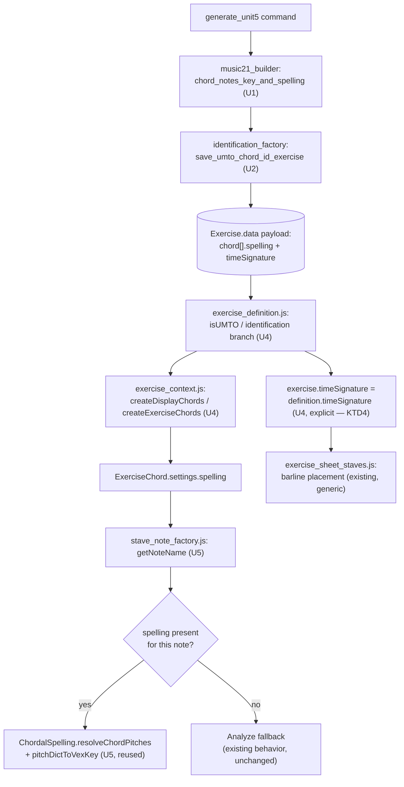

# fix: Unit 5 chord spelling and barline rendering

## Summary

Fixes two rendering bugs in Unit 5 chord-identification exercises — wrong enharmonic spelling (e.g. `D#-G-Bb-Eb` instead of the chord's actual spelling) and missing barlines — by adding a `spelling` field and a `timeSignature` key to the existing identification payload, end to end from generation through rendering. Alongside the fix, extracts three pieces of logic that this bug touches into focused modules: chord-identification save/build logic out of the oversized `umto_factory.py`, chord-quality/spelling generation logic into the existing `apps/exercises/generation/` package, and a frontend spelling-resolution utility out of the stave renderer.

## Problem Frame

Unit 5 chord-identification exercises (`apps/exercises/management/commands/generate_unit5.py`) currently store only MIDI note integers per chord. The frontend re-derives spelling on the fly via `Analyze` under a single key signature (`lab/static/js/src/components/music/stave_note_factory.js:228`), which produces musically wrong spellings for some chord qualities (e.g. augmented triads, where the raised 5th needs a sharp spelling distinct from its enharmonic minor-6th neighbor). Separately, the saved payload never sets a `timeSignature` key (only `meter`), so `exercise_definition.js:1375-1377` defaults `exercise.timeSignature` to `false` and the generic barline-placement logic in `exercise_sheet_staves.js:473-488` never fires — worksheets render as one continuous staff with no bar divisions.

An earlier draft of this fix proposed switching the payload to `score_kind="chordal"` with a populated `umto.chords` (`ChordEvent`) list. Tracing the actual identification render path (`exercise_definition.js` → `exercise_context.js` → `ExerciseChordBank` → `stave_note_factory.js`) confirmed it never reads `score.measures` or `umto.chords` for `type: "identification"` exercises — that data would be unused plumbing. This plan instead adds `spelling` and `timeSignature` directly to the payload shape the render path already consumes (see KTD1). It does, however, reuse an existing spelling-resolution module from that chordal pipeline on the frontend (see KTD6) — the two decisions are independent: reject the chordal *payload shape*, reuse the chordal *spelling-resolver code*, which already implements the exact "recorded spelling first, key-aware default fallback" behavior this fix needs.

The repo has a documented "oversized modules" debt list that names `umto_factory.py` (`docs/architecture/engineering-principles.md:82`) alongside an active architecture-simplification effort (P2: "service extraction from oversized modules") whose *tracked, in-progress* work is currently elsewhere (`generate_exercise_context` out of `lab/views.py`, with `student/views.py`/`models.py`/`forms.py` named as next candidates). `umto_factory.py` is not yet a scheduled P2 target — this plan's extraction is a new, independent single-function extraction that follows the same established pattern, not a continuation of in-flight P2 work. This bug's backend fix touches exactly one function in isolation, making it a low-risk opportunity to extract it — along with two sibling extractions the fix naturally motivates — without expanding scope into the rest of the module.

---

## Requirements

**Correctness**
- R1. Unit 5 chord-identification exercises render notes with the chord's exact recorded enharmonic spelling, not a spelling re-derived from MIDI under the display key signature.
- R2. Unit 5 chord-identification exercises render with visible barlines, one worksheet chord per measure.

**Data flow and regression safety**
- R3. Spelling data flows unbroken from generation → saved `Exercise.data` payload → frontend problem objects → `ExerciseChord` → VexFlow note rendering.
- R4. Legacy and non-Unit-5 identification exercises that carry no `spelling` data continue to render exactly as they do today — the fix adds a new data path, it does not replace the existing fallback for exercises that predate it.

**Modularization**
- R5. Chord-identification save/build logic, chord-quality/spelling generation logic, and frontend spelling-resolution logic each live in a module scoped to that single responsibility, rather than inside the oversized `umto_factory.py`, inlined in the management command, or inlined in the stave renderer.

---

## Key Technical Decisions

- **KTD1 — Direct payload-field additions, not chordal UMTO**: add `spelling` to each chord dict and `timeSignature` to the top-level payload in the existing `identification`-type payload shape, rather than switching to `score_kind="chordal"` with `ChordEvent`/`umto.chords`. *Rationale:* the identification render pipeline (`exercise_definition.js` fallback mapper → `exercise_context.js` → `ExerciseChordBank` → `stave_note_factory.js`) never reads `score.measures` or `umto.chords`; that data would be built and validated (`umto.py:194-200`'s `score_kind` validator) but never consumed.

- **KTD2 — Spelling strings always carry octave** (VexFlow `"eb/4"` form, not bare letter+accidental): this repo has a hard, incident-backed rule that pitch spelling without octave silently corrupts downstream bass/interval computation (`docs/music-theory-canon.md:67-89`, `AGENTS.md:82`; production incident PR #209-211). VexFlow's own spelling format already carries octave, so this falls out naturally as long as the conversion helper preserves it.

- **KTD3 — Spelling and MIDI-note order are derived from one sort, not two**: the generation helper sorts the voiced `music21` pitch objects by MIDI once, then derives both `midi_notes` and `spelling` from that single ordering. Sorting `midi_notes` and computing `spelling` independently would risk index misalignment between the two lists.

- **KTD4 — `timeSignature` requires an explicit assignment inside the `isUMTO`/`identification` branch, not just the generic downstream read**: `ExerciseDefinition.parse()` branches on `if (definition.isUMTO)` at `exercise_definition.js:896`, and the `identification` sub-branch inside that block (lines 1096-1115) `return`s at line 1120 — *before* the generic `exercise.timeSignature = definition.timeSignature` read at line 1375 is ever reached. Since `save_umto_chord_id_exercise`'s payload always sets `isUMTO: True`, adding `timeSignature` to the payload alone is not sufficient — R2 requires an explicit `exercise.timeSignature` assignment inside the `isUMTO`/`identification` branch itself (see U4). Verified directly against the current file; this is the actual mechanism, not the generic fallback originally assumed.

- **KTD5 — Frontend spelling resolution matches by MIDI value, not positional array index**: `stave_note_factory.js`'s `getNoteKeys()` iterates `this.chord.getNoteNumbers(this.clef)` — a clef-specific subset of the chord (keyboard staff distribution splits notes across treble/bass). A per-stave positional index into a full-chord spelling array would misalign once a chord splits across staves. Resolving by a `{midi: spelling}` map keyed on the full sorted note list avoids this.

- **KTD6 — Reuse `ChordalSpelling.resolveChordPitches`, don't build a new resolver module**: `lab/static/js/src/components/music/chordal_spelling.js` already exports `resolveChordPitches(chord, spellingTable)`, which takes a `{visible, hidden, spelling}`-shaped chord and returns a `{midi: {step, alter, octave}}` map — using recorded `spelling` strings when present and falling back to a key-aware default spelling otherwise. This is already the exact "recorded spelling first, fallback second" behavior R1/R4 need, already used across the identification-related rendering components (`exercise_sheet_identification*.js`, `exercise_sheet_staves.js`, `umto_score_converter.js`) and already covered by `chordal_spelling.test.js`. U5 extends this existing module with one small addition (a `{step,alter,octave}` → VexFlow key-string converter) rather than writing a parallel resolver from scratch.

- **KTD7 — Legacy fallback preserved, not treated as a new guess**: when `spelling` data is absent (any exercise generated before this fix, or any other identification exercise type), `getNoteName` keeps using the existing `Analyze`-based resolution. This is the current behavior for every exercise ever rendered before this fix — not a new silent guess introduced by it — so it does not conflict with the "no silent fallback" rule, which governs *new* data this plan controls, not pre-existing behavior it leaves untouched.

- **KTD8 — Three extractions, each mirroring an existing convention, none introducing a new one**: `apps/exercises/generation/` already holds pure music21-boundary helpers with no Django dependency (`music21_builder.py`); `chordal_spelling.js` in `lab/static/js/src/components/music/` is the established home for spelling-resolution logic (KTD6); the identification save/build logic has exactly one caller (`generate_unit5.py`), making it a low-blast-radius, single-import-line extraction. `Exercise.clean()`'s UMTO guard (`apps/exercises/models.py:248-269`) checks `data["isUMTO"]`, not the calling file path, so extracting the save function to a new module does not require special-casing the guard.

---

## Implementation Units

### U1. Extract chord-quality and VexFlow spelling generation into `apps/exercises/generation/music21_builder.py`

**Goal:** Move the chord-quality-to-notes computation out of the management command and add VexFlow spelling-string generation, both sourced from a single sorted pitch list.

**Requirements:** R1, R3, R5

**Dependencies:** None (first unit)

**Files:**
- `apps/exercises/generation/music21_builder.py` — add `chord_notes_key_and_spelling(key_str, quality, chord_type)` and a small `pitches_to_vexflow_spelling(pitches)` converter, placed beside the existing `spelling_key_for_pitches`
- `apps/exercises/tests/test_music21_builder.py` — new test coverage
- `apps/exercises/management/commands/generate_unit5.py` — delete `_chord_notes_and_key`, import and call the new function

**Approach:** `chord_notes_key_and_spelling` returns a 3-tuple `(midi_notes, display_key, spelling)` — the existing call site already needs `display_key` for `worksheet_key`/`chord_key`, so the new function keeps returning it alongside the new `spelling` list. It sorts the voiced `music21.pitch.Pitch` objects by `.midi` once, then derives `midi_notes` (the `.midi` values) and `spelling` (via `pitches_to_vexflow_spelling`) from that same ordered list — never re-sorting either independently. `pitches_to_vexflow_spelling` converts each pitch's `nameWithOctave` (music21's `-`/`#` accidental convention, e.g. `"E-4"`) into VexFlow's lowercase `step[accidental]/octave` form (e.g. `"eb/4"`), reusing the same `-`→`b` normalization `spelling_key_for_pitches` already applies to `p.name` (line 170), just applied to `p.nameWithOctave` instead.

**Patterns to follow:** `spelling_key_for_pitches` in the same file — pure function, no Django/DB dependency, takes `music21` pitch objects, returns a plain value.

**Test scenarios:**
- Happy path: C major triad root position → `midi_notes=[60,64,67]`, `spelling=["c/4","e/4","g/4"]`
- Happy path: Eb major triad → spelling uses flats (`"eb/4","g/4","bb/4"`), matching the chord's actual key orientation
- Edge case: 4-voice keyboard voicing with a doubled pitch class at a different octave (e.g. C4, E4, G4, C5) → 4 spelling entries, doubled note spelled identically at its own octave
- Edge case: augmented triad (raised 5th) → the raised-5th spelling is distinct from its enharmonic minor-6th neighbor — this is the exact case the reported bug (`D#-G-Bb-Eb`) came from
- Edge case: diminished/half-diminished seventh chord in a flat key → all spellings consistent with the key's flat orientation
- Integration: parametrized across every `(quality, root)` pair in `generate_unit5.py`'s `ALL_ROOTS` × quality pools, `spelling[i]` and `midi_notes[i]` always describe the same pitch — the index-alignment invariant the rest of the fix depends on

**Verification:** `pytest apps/exercises/tests/test_music21_builder.py` passes; every returned spelling string matches `^[a-g][b#]*\/[0-9]+$` (always carries an octave).

---

### U2. Extract chord-identification save/build logic into a new module, add `spelling` and `timeSignature` to the payload

**Goal:** Move `save_umto_chord_id_exercise` out of `umto_factory.py` into a focused module, and add the two payload fields the frontend needs.

**Requirements:** R1, R2, R3, R5

**Dependencies:** U1 (consumes its `spelling` output via the chords list)

**Files:**
- New module, e.g. `apps/exercises/identification_factory.py` — the extracted `save_umto_chord_id_exercise`
- `apps/exercises/umto_factory.py` — remove the function
- `apps/exercises/management/commands/generate_unit5.py` — update the import
- New test file, e.g. `apps/exercises/tests/test_identification_factory.py`

**Approach:** Behavior stays identical to the current function except: each entry in the payload's `"chord"` list gains `"spelling": c.get("spelling")` when the input chord dict carries it; the top-level payload dict gains `"timeSignature"` set to the same `"4/4"` value already hardcoded for `"meter"`. No `score_kind`, `ChordEvent`, or `umto` sub-object changes — the `umto` payload stays voices-based exactly as today (see KTD1). This payload addition is necessary but not sufficient for R2 — the payload key must also be read by an explicit frontend assignment inside the `isUMTO`/`identification` branch; see KTD4 and U4.

**Patterns to follow:** the `save_umto_*` function bodies remaining in `umto_factory.py` for the Exercise-row create/overwrite/backfill idiom; `apps/exercises/services/` for the shape of a focused, Django-aware save module.

**Test scenarios:**
- Happy path: chords list with `spelling` → saved `Exercise.data["chord"][i]["spelling"]` matches input, `Exercise.data["timeSignature"] == "4/4"`
- Happy path: chords list without `spelling` (back-compat call) → chord entries have no `spelling` key (or `None`), no exception raised
- Edge case: `overwrite=True` path updates `spelling`/`timeSignature` on an existing `Exercise` row, not just the create path
- Regression: this payload shape carries no per-problem `hidden` flag today — confirm the extraction doesn't introduce one, given the boolean-vs-array footgun documented for identification payloads elsewhere in this codebase
- Integration: an end-to-end call from `generate_unit5`'s worksheet-building loop through the new module produces an `Exercise` whose data has both `spelling` and `timeSignature` present

**Verification:** `pytest apps/exercises/tests/test_identification_factory.py` passes; `pytest apps/exercises/tests/test_umto_factory.py` still passes (confirms the extraction didn't disturb the remaining `save_umto_*` functions). Note: `Exercise.data["timeSignature"]` being present does not by itself confirm barlines render — that requires the frontend fix in U4 (KTD4); U2's own verification is payload-shape only.

---

### U3. Wire spelling into `generate_unit5.py`'s worksheet-building loop

**Goal:** Connect U1's spelling output to U2's chord-list input.

**Requirements:** R1

**Dependencies:** U1, U2

**Files:** `apps/exercises/management/commands/generate_unit5.py`

**Approach:** In `_handle_type`'s per-chord loop, call the new `chord_notes_key_and_spelling` and append `"spelling": spelling` to each chord dict alongside the existing `"notes"`, `"answer"`, `"choices"`, `"rhythmValue"` entries.

**Test expectation:** none — pure wiring between two already-tested units (U1, U2), no new branching or logic of its own.

**Verification:** `python manage.py generate_unit5 --author <local-author> --overwrite` runs without error against a local dev DB; spot-check one saved `Exercise.data["chord"][0]["spelling"]`.

---

### U4. Frontend: carry `spelling` through the identification problem/chord pipeline, and fix `timeSignature` at its actual read site

**Goal:** Get `spelling` from the definition payload onto `ExerciseChord.settings` so the stave renderer can see it, and set `exercise.timeSignature` where the `isUMTO`/`identification` branch actually reads it (KTD4) so R2 is genuinely fixed rather than assumed fixed by a generic downstream read that's never reached.

**Requirements:** R1, R2, R3

**Dependencies:** none directly, but needs U2's payload shape to test end-to-end

**Files:**
- `lab/static/js/src/models/exercise_definition.js` — `isUMTO`/`identification` branch (~lines 1096-1120), including the `parse()` early return at line 1120
- `lab/static/js/src/models/exercise_context.js` — `createDisplayChords`/`createExerciseChords` (~lines 1346-1438)

**Approach:** In the `isUMTO`/`identification` branch (inside `if (definition.isUMTO) { ... else if (exercise.type === "identification") { ... } }`, which `return`s at line 1120), add `spelling: chord.spelling || null` to the mapped problem object (mirroring how `answer`/`choices`/`rhythm` are already carried through) **and** add an explicit `exercise.timeSignature = definition.timeSignature || false;` assignment in the same branch, alongside the existing `exercise.staffDistribution`/`exercise.analysis` assignments — this branch returns before the file's generic `exercise.timeSignature` read at line 1375 is ever reached, so that generic read does not apply here (KTD4). In `createDisplayChords`/`createExerciseChords`, read `problems[i].spelling` and pass `spelling: spelling` into `new ExerciseChord({...})`, mirroring the existing `unison_idx` plumbing through the same two call sites.

**Patterns to follow:** `unison_idx`'s existing path through these exact same three call sites for the `spelling` plumbing — same shape, one more field. The `timeSignature` assignment mirrors how the same branch already assigns `exercise.staffDistribution`/`exercise.inputMode` directly from `definition.*`, rather than relying on shared post-branch code.

**Test scenarios:**
- Happy path: `definition.chord[0].spelling` present → the resulting problem object carries the same array under `.spelling`
- Edge case: `definition.chord[0]` has no `spelling` key (legacy exercise) → `problem.spelling` is `null`, not `undefined`, and nothing downstream throws
- Integration: an `ExerciseChord` built via `createExerciseChords`/`createDisplayChords` from a problem with `.spelling` exposes it at `chord.settings.spelling`
- Happy path (R2): `definition.isUMTO === true`, `definition.type === "identification"`, `definition.timeSignature === "4/4"` → `ExerciseDefinition.parse(definition).timeSignature === "4/4"` (not `false`) — this is the regression test for KTD4's actual bug
- Edge case (R2): `definition.isUMTO === true`, `definition.type === "identification"`, no `timeSignature` key (legacy exercise) → `exercise.timeSignature === false`, matching current behavior, no barlines forced on old data

**Verification:** the `spelling`-plumbing scenarios are exercised end-to-end via U5's test file (the consuming logic lives there); the two `timeSignature` scenarios need a new co-located `exercise_definition.test.js` exercising `ExerciseDefinition.parse()` directly (no test file currently exists for this model) since nothing else in this plan exercises `parse()` in isolation.

---

### U5. Frontend: extend `chordal_spelling.js` with a VexFlow-key converter, wire into stave rendering

**Goal:** Resolve a MIDI note to its recorded spelling when available, using the existing `ChordalSpelling.resolveChordPitches` resolver rather than a new one, and wire the result into `stave_note_factory.js` ahead of the existing `Analyze` fallback.

**Requirements:** R1, R3, R4, R5

**Dependencies:** U4

**Files:**
- `lab/static/js/src/components/music/chordal_spelling.js` — add a `pitchDictToVexKey({step, alter, octave})` converter, co-located with the existing `vexKeyToSpellingString` (the reverse-direction converter already in this file)
- `lab/static/js/src/components/music/chordal_spelling.test.js` — add coverage for the new converter
- `lab/static/js/src/components/music/stave_note_factory.js` — `getNoteName` (~line 228)

**Approach:** `chordal_spelling.js` already exports `resolveChordPitches(chord, spellingTable)` (KTD6), which takes a `{visible, hidden, spelling}`-shaped chord and returns a `{midi: {step, alter, octave}}` map — resolving from `chord.spelling` when present, falling back to a key-aware default otherwise. `getNoteName` builds a chord-shaped argument from `this.chord.settings.spelling` and `all_note_nums` (the full sorted note list `getNoteKeys()` already resolves), calls `ChordalSpelling.resolveChordPitches({visible: all_note_nums, spelling: this.chord.settings.spelling}, null)`, looks up the entry for `note`, and converts it to a VexFlow key string via the new `pitchDictToVexKey`. Matching happens by MIDI value inside `resolveChordPitches` already (it builds `byMidi` keyed on the note values in `allMidis`), so it inherits the correct behavior across a keyboard-split chord (KTD5) for free — no new positional-index logic needed. When `this.chord.settings.spelling` is absent, skip this path entirely and call `this._makeAnalyzer().getNoteName(...)` exactly as today (KTD7).

**Patterns to follow:** `vexKeyToSpellingString` in the same file, which does the equivalent conversion in the opposite direction (`"bb/4"` → `"Bb4"`) — `pitchDictToVexKey` is its structural sibling (`{step:"B", alter:-1, octave:4}` → `"bb/4"`). `umto_score_converter.js`'s existing call to `ChordalSpelling.resolveChordPitches` for the calling convention.

**Test scenarios:**
- Happy path: `pitchDictToVexKey({step:"E", alter:-1, octave:4})` → `"eb/4"`
- Happy path: Eb major triad chord (`visible:[63,67,70], spelling:["eb/4","g/4","bb/4"]`) → `resolveChordPitches` + `pitchDictToVexKey` round-trips each note back to its recorded spelling, not a re-derived one — this is the exact case the reported bug (`D#-G-Bb-Eb`) came from
- Edge case: `this.chord.settings.spelling` absent → `getNoteName` never calls `resolveChordPitches`, falls straight to `Analyze`, matching current output byte-for-byte for exercises generated before this fix
- Edge case: doubled pitch class at two octaves (two "c" naturals, different MIDI values) → each resolves independently and correctly, since `resolveChordPitches`'s `byMidi` map is keyed by MIDI value, not letter name
- Integration: on a keyboard-split chord (some notes on treble, some on bass), `getNoteKeys()` resolves correct spelling on both staves from the one full-chord `spelling` array passed into `resolveChordPitches` — confirms the per-stave subset iteration in `getNoteKeys()` doesn't break MIDI-based resolution (KTD5)

**Verification:** `node lab/static/js/src/components/music/chordal_spelling.test.js` passes; after U1-U4 land and Unit 5 exercises are regenerated (U3's verification step), a manual browser check of a regenerated worksheet shows correct spelling on a chord previously observed wrong (e.g. Eb major no longer rendering as `D#-G-Bb-Eb`) and visible barlines between chords (R2).

---

## High-Level Technical Design

---

## Scope Boundaries

**In scope:** Unit 5 triad and seventh-chord identification exercises (`generate_unit5.py`'s two playlists) and the three extractions named in KTDs and R5.

**Deferred to Follow-Up Work:**
- The remaining five `save_umto_*` functions stay in `umto_factory.py` — this plan extracts only the one this bug touches, not a full module breakup.
- Re-running `generate_unit5` in any deployed environment (staging/prod) beyond local dev verification — this plan covers the code fix and local regeneration; a prod rollout of `--overwrite` regeneration is a separate operational step, flagged under Risks below.
- Extending spelling-aware rendering to other identification-exercise generators that share `stave_note_factory.js` — they don't emit `spelling` data yet, so they continue falling back to `Analyze` exactly as before (correct no-op, not a gap this plan needs to close).
- Documentation sync: `docs/UMTO_GUIDE.md`, `docs/exercise_types.md`, `apps/exercises/umto_schema.json`, and `docs/unit_5_triads_seventh_chords_plan.md`'s "Key files" section don't currently document `timeSignature` or the post-extraction module location. None of these gate correctness (the `umto_schema.json` validation only covers the `umto` sub-object, not the top-level `chord`/`timeSignature` keys), so updating them is a documentation-hygiene follow-up, not a blocking unit.

**Out of scope:** the `score_kind="chordal"`/`ChordEvent` approach from the earlier draft plan — explicitly rejected (KTD1).

---

## Risks & Dependencies

- **Stale prod/staging data**: any Unit 5 exercises already generated in a deployed environment predate this fix and lack `spelling`/`timeSignature`. They will keep rendering with the old bug until re-generated with `--overwrite` — this is not automatic. Same operational pattern as the prior transposition-octave-bug cleanup (PR #209-211), which required an explicit re-run against named source exercises.
- **Index-alignment regression risk**: any future change to `_pitches_for_quality`/`_keyboard_4voice` voicing order that bypasses U1's single-sort discipline could silently desync `midi_notes` and `spelling` again. Since U5 reuses `resolveChordPitches`, a desync wouldn't surface as an error — unmatched notes would silently fall through to `keyAwarePitch`'s sharp-spelling default rather than the recorded spelling, reproducing a version of the original bug. Mitigated by U1's parametrized index-alignment test, which should be treated as a guard test, not just initial coverage.
- **Dependency**: relies on `music21`'s `Pitch.nameWithOctave` semantics staying stable — already a load-bearing assumption elsewhere in this codebase (`docs/music-theory-canon.md`).

---

## Sources / Research

- `apps/exercises/umto_factory.py:1179-1294` — current `save_umto_chord_id_exercise` implementation
- `apps/exercises/management/commands/generate_unit5.py:72-90` — current `_chord_notes_and_key`
- `apps/exercises/generation/music21_builder.py:147-187` — `spelling_key_for_pitches`, source of the `-`→`b` normalization pattern U1 reuses
- `lab/static/js/src/models/exercise_definition.js:896-1121, 1375-1378` — `isUMTO`/`identification` branch and its early `return` at line 1120 (KTD4's actual mechanism), generic `timeSignature` read that the branch never reaches
- `lab/static/js/src/models/exercise_context.js:1346-1438` — `createDisplayChords`/`createExerciseChords`
- `lab/static/js/src/components/music/stave_note_factory.js:184-231` — `getNoteKeys`/`getNoteName`
- `lab/static/js/src/components/music/exercise_sheet_staves.js:473-488` — barline placement keyed off `exercise.timeSignature`
- `lab/static/js/src/components/music/chordal_spelling.js:58-96` — `resolveChordPitches`, `vexKeyToSpellingString`; the established spelling-resolution module U5 extends (KTD6), already used by `umto_score_converter.js`, `exercise_sheet_identification*.js`, `exercise_sheet_staves.js`, and others
- `apps/exercises/umto.py:131-200` — `Metadata.score_kind` validator, confirms why the chordal path doesn't apply here
- `apps/exercises/models.py:248-269` — `Exercise.clean()` UMTO guard checks `data["isUMTO"]`, not call-site file, so extraction is safe
- `docs/music-theory-canon.md:67-89` — "Pitch spelling and octave are load-bearing data"
- `docs/architecture/engineering-principles.md:82` — "Oversized modules" debt list naming `umto_factory.py`
- `AGENTS.md:82, 101-102` — replacement/retirement policy; "extract a focused module" guidance
- Institutional learnings: identification `problem.hidden` boolean-vs-array gotcha; transposition octave bug PR #209-211; architecture-simplification P2 service-extraction effort (tracked work is elsewhere; this extraction is independent, see Problem Frame)
