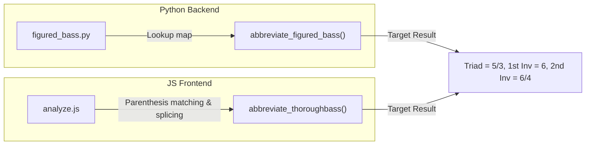

# HarmonyLab Codebase Redundancy & Algorithmic Duplication Analysis

This document provides a comprehensive, deep-dive architectural analysis of duplicate structures, parallel routing pathways, and cross-language algorithmic duplications in the HarmonyLab codebase. 

---

## 1. Local IDE Brain vs. Codebase Persistence

### ⚠️ Where Artifacts Live by Default
When Antigravity runs analyses and creates reports, these files are saved under the IDE's local App Data Directory (specifically in the `.gemini` local brain cache):
`file:///Users/adorman/.gemini/antigravity-ide/brain/0726b46c-a6ce-4d51-8a19-f8a3b3dc9b40/`

### 💡 Why Storing in the Codebase is Essential
* **No Re-Analysis Needed**: If you clear your IDE cache, switch branches, or switch workstations, these brain-resident files are lost.
* **Searchable & Committed**: Placing this report in [docs/redundancy_analysis_report.md](file:///Users/adorman/Library/CloudStorage/Dropbox/Codebases/HarmonyLab-1/docs/redundancy_analysis_report.md) commits it directly into your Git workspace, preserving it for you and your development team.
* **Traceability**: Future refactoring efforts can directly reference this document as a backlog check-item list.

---

## 2. Cross-Language Algorithmic Duplication (Python vs. JavaScript)

Because HarmonyLab executes complex music theory calculations both on the **backend (Python)** (during exercise imports, migrations, and harmonic backfills) and on the **frontend (JavaScript)** (for real-time grading, VexFlow rendering, and interactive feedback), several core music theory algorithms are duplicated verbatim across language boundaries.

### A. Figured Bass Abbreviation (Kellner Rules)
To clean up dense stack intervals (e.g., converting a raw stack like `8/5/3` to the standard triad `5/3`, or `8/6/3` to `6`), both Python and JavaScript implement the Kellner Figured Bass shorthand rules.

* **Python Implementation**: [figured_bass.py:L91-156](file:///Users/adorman/Library/CloudStorage/Dropbox/Codebases/HarmonyLab-1/apps/exercises/utils/figured_bass.py#L91-156) (`abbreviate_figured_bass(raw)`)
* **JavaScript Implementation**: [analyze.js:L1311-1448](file:///Users/adorman/Library/CloudStorage/Dropbox/Codebases/HarmonyLab-1/lab/static/js/src/utils/analyze.js#L1311-1448) (`abbreviate_thoroughbass(intervals)`)



#### Code Comparison & Structural Analysis:
* **The Python version** uses an explicit lookup map `_ABBREV_MAP` mapping descending numeric tuples (e.g., `("8", "7", "5", "3")` to `"7"`) and uses regex splitting to separate accidentals from numeric keys before reattaching them.
* **The JavaScript version** uses an internal custom `Stack` class inside the function, executing string manipulation methods (`parenth`, `third_as_accidental`, `relativize`) to parenthesize elements in the stack sequentially (e.g., parenthesizing `5` and `3` if the stack matches `["7", "5", "3"]`) and then calls `expunge_parenthesized()` to clean the stack.

> [!TIP]
> **Refactoring Path**: Both represent stable musical rules, but they are highly fragile to spelling changes. Any alteration to the backend's abbreviation logic (e.g., handling chromatic alterations like `+` tritones) must be manually ported to the frontend's parenthesization logic to prevent visual-vs-grader mismatches.

---

### B. Key Normalization (Tonic / Mode String Mapping)
Converting user-entered key strings or raw CIR keys (like `Bb`, `F#m`, `C`) into HarmonyLab's internal format (where minor keys are prefixed with `i`, major with `j`, and naturals are suffixed with an underscore e.g., `jBb`, `iF#`, `jC_`) is duplicated across:

* **Python Implementation**: [transpose.py:L28-38](file:///Users/adorman/Library/CloudStorage/Dropbox/Codebases/HarmonyLab-1/apps/exercises/utils/transpose.py#L28-38) (`normalize_key(k)`)
* **JavaScript Implementation**: [exercise_definition.js:L574-599](file:///Users/adorman/Library/CloudStorage/Dropbox/Codebases/HarmonyLab-1/lab/static/js/src/models/exercise_definition.js#L574-599) (`convertCIRKeyToHarmonyLabKey(cirKey)`)

#### Side-by-Side Comparison:
```python
# Python
def normalize_key(k):
    if not k or k == "h" or k in all_keys:
        return k
    is_minor = k.endswith('m')
    prefix = 'i' if is_minor else 'j'
    note = k[:-1] if is_minor else k
    suffix = "_" if ("#" not in note and "b" not in note) else ""
    return prefix + note + suffix
```

```javascript
// JavaScript
function convertCIRKeyToHarmonyLabKey(cirKey) {
  if (!cirKey || typeof cirKey !== 'string') return 'jC_';
  if ((cirKey.startsWith('i') || cirKey.startsWith('j')) && cirKey.length >= 2 && /^[A-G]/.test(cirKey[1])) {
      return cirKey; // Idempotency check
  }
  var isMinor = cirKey.endsWith('m') || (cirKey.length > 0 && cirKey[0] === cirKey[0].toLowerCase());
  var prefix = isMinor ? 'i' : 'j';
  var note = isMinor && cirKey.endsWith('m') ? cirKey.slice(0, -1) : cirKey;
  if (note.length > 0) {
      note = note[0].toUpperCase() + note.slice(1);
  }
  note = note.replace('-', 'b');
  var suffix = (note.indexOf('#') === -1 && note.indexOf('b') === -1) ? '_' : '';
  return prefix + note + suffix;
}
```

> [!IMPORTANT]
> Both algorithms handle the exact same normalization paths, but the JS version includes additional safety logic (`idempotency check`, lowercase minor checks, hyphen-to-flat substitution `replace('-', 'b')`). This discrepancy can lead to situations where a key parsed cleanly on the frontend fails to align with backend transposition lookups.

---

### C. Pitch Spelling to MIDI Number Calculation
Mapping standard music pitch notations (letter steps, accidental alters, octave numbers) to standard MIDI pitch values is duplicated in:

* **Python Implementation**: [music21_builder.py:L148-162](file:///Users/adorman/Library/CloudStorage/Dropbox/Codebases/HarmonyLab-1/apps/exercises/utils/music21_builder.py#L148-L162) (`_pitch_to_midi(pitch_data)`)
* **JavaScript Implementation**: [score_timeline.js:L15-34](file:///Users/adorman/Library/CloudStorage/Dropbox/Codebases/HarmonyLab-1/lab/static/js/src/components/music/score_timeline.js#L15-34) (`pitchToMidi(pitch)`)

#### Side-by-Side Comparison:
```python
# Python
step_semitones = {
    'C': 0, 'D': 2, 'E': 4, 'F': 5,
    'G': 7, 'A': 9, 'B': 11
}
semitone = step_semitones.get(step, 0)
midi = (octave + 1) * 12 + semitone + alter
```

```javascript
// JavaScript
function stepToSemitone(step) {
  switch (step.toUpperCase()) {
    case 'C': return 0;
    case 'D': return 2;
    // ...
  }
}
var semitone = base + alter;
return (octave + 1) * 12 + semitone;
```

---

### D. Note Duration Scale Conversion (Quarter Length vs. Ticks)
The system models rhythmic duration via two distinct coordinate scales:
1. **Quarter Length (Float)**: Used in Python via `music21` analysis tools where `1.0` = Quarter Note, `4.0` = Whole Note.
2. **Ticks (Integer)**: Used in the frontend VexFlow and playback timelines where `1024` = Quarter Note, `4096` = Whole Note.

* **Python Conversion**: [music21_builder.py:L135-145](file:///Users/adorman/Library/CloudStorage/Dropbox/Codebases/HarmonyLab-1/apps/exercises/utils/music21_builder.py#L135-L145) (`_dur_to_quarter_length(dur_type)`)
* **JavaScript Conversion**: [score_timeline.js:L6-13](file:///Users/adorman/Library/CloudStorage/Dropbox/Codebases/HarmonyLab-1/lab/static/js/src/components/music/score_timeline.js#L6-L13) (`durToTicks(d)`)

---

## 3. Structural Duplication: Parallel Django Applications

The repository currently maintains two concurrent routing, view, and template structures for delivering music exercises:

```mermaid
graph TD
    subgraph Legacy App (lab)
        A["lab.views.PlaylistView"] -->|renders| B["lab/exercise.html"]
    end
    
    subgraph Modern Student App (apps/student)
        C["student.views.PlayerView"] -->|renders| D["student/player.html"]
    end

    B & D -->|both bootstrap| E["AMD: app/main"]
    B & D -->|both fetch context| F["lab.views.generate_exercise_context"]
```

### Fragility & Redundancies in `player.html`:
The new [player.html](file:///Users/adorman/Library/CloudStorage/Dropbox/Codebases/HarmonyLab-1/apps/student/templates/student/player.html) provides a premium, responsive UI. However, because the underlying AMD JavaScript modules (e.g., `exercise_sheet.js`, `TextInputComponent`) still render elements according to the old layout structure (like `#identification-actions` and `#ident-input-container`), the new player must perform **runtime DOM surgery** using `MutationObserver` instances to relocate elements:

* **Mutation Observer 1 (Toolbar Slot)**: Catches insertion of `#ident-toggle-row` (mode selectors) inside `#identification-actions` and prepends it to the header `#ident-toolbar-slot`.
* **Mutation Observer 2 (Progress Bar)**: Intercepts `#ident-progress-container` and prepends it into `#s-answer-bar`.
* **Mutation Observer 3 (Input Field Wrapper)**: Relocates `#ident-input-container` into the persistent answer bar footer.
* **Capture-Phase Click Interceptor**: Simulates submission clicks by intercepting the customized Check button (`#identification-submit`) and invoking a hidden `.text-id-check` button in the AMD module.

---

## 4. Taxonomic & Configuration Redundancies

### The Allowlist Mapping Discrepancy
As outlined in [AGENTS.md](file:///Users/adorman/Library/CloudStorage/Dropbox/Codebases/HarmonyLab-1/AGENTS.md), Unit 9 is hardcoded as an allowlist array (`I`, `i`, `V`, `V7`) inside the frontend code in `exercise_definition.js`. Meanwhile, the backend database relies on [music_theory_taxonomy_with_branches.json](file:///Users/adorman/Library/CloudStorage/Dropbox/Codebases/HarmonyLab-1/music_theory_taxonomy_with_branches.json) as the source of truth for units and tags. 

* **The redundancy**: Pedagogical taxonomies are defined in structured JSON on the backend, but their filtering constraints are hardcoded into frontend JS views. This blocks scaling playlist features to other units without copy-pasting code.

---

## 5. Structured Roadmap to Eliminate Redundancies

To systematically reduce this debt and streamline the code, we recommend a phased approach:

| Phase | Target Component | Action Item | Benefit |
|:---|:---|:---|:---|
| **Phase 1** | **Consolidate Allowlist** | `exercise_definition.js` | Replace the hardcoded list with a dynamic lookup derived from `music_theory_taxonomy_with_branches.json` (resolves Blocker 1). |
| **Phase 2** | **Unify Context Utilities** | `apps/exercises/utils/` | Move `generate_exercise_context` and adaptive fetch helpers out of `lab/views.py` into a shared, app-agnostic backend utility module. |
| **Phase 3** | **Retire Old `lab` Views** | `lab/views.py` | Deprecate and remove old playlist views in favor of the progression-based `student` app player. |
| **Phase 4** | **Re-architect AMD DOM** | `lab/static/js/src/` | Refactor the AMD components to render clean, modular container slots directly, completely eliminating the fragile `MutationObserver` hacks in `player.html`. |
| **Phase 5** | **Complete UMTO Migration** | DB & Scripts | Complete tag backfills on legacy exercise records to make them fully compliant with the UMTO spec, allowing for the total deletion of legacy serialization fallbacks. |
