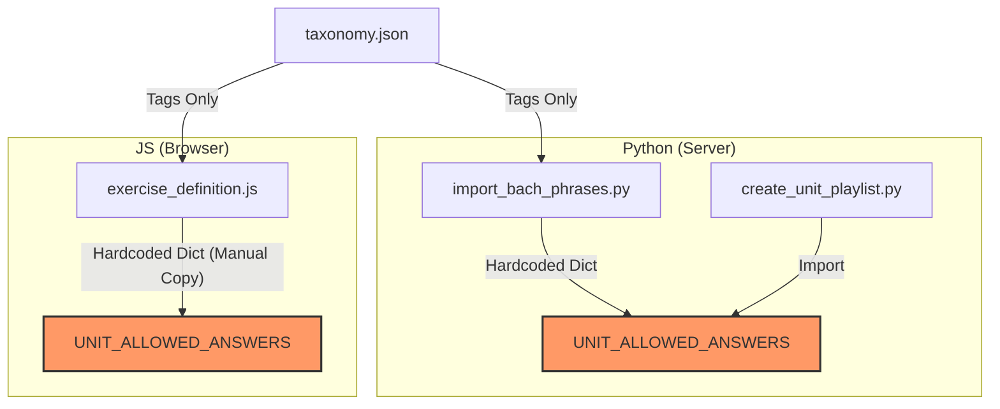
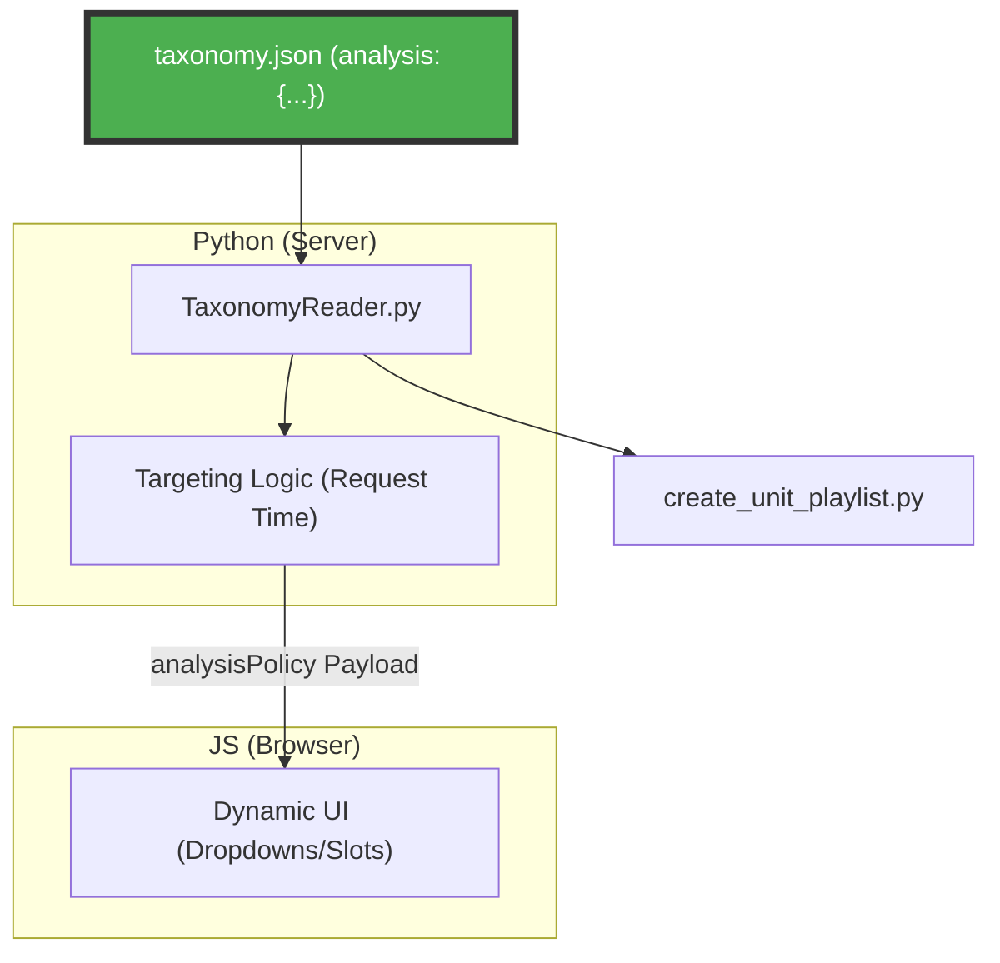
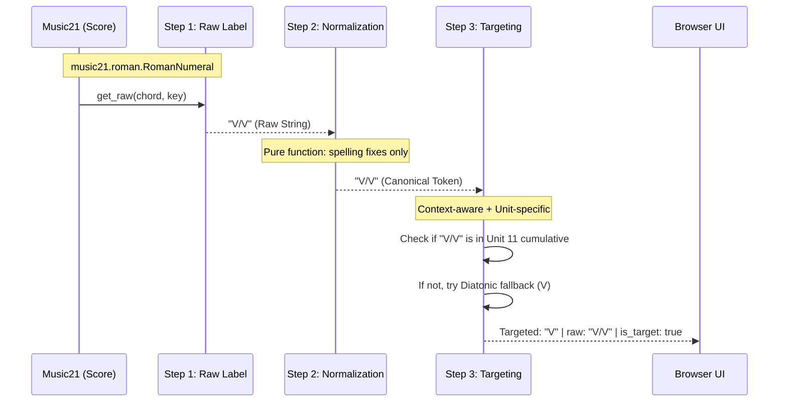
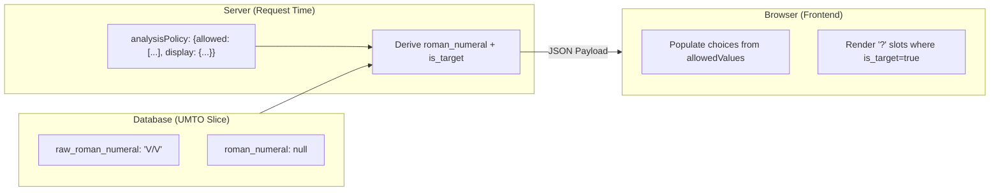
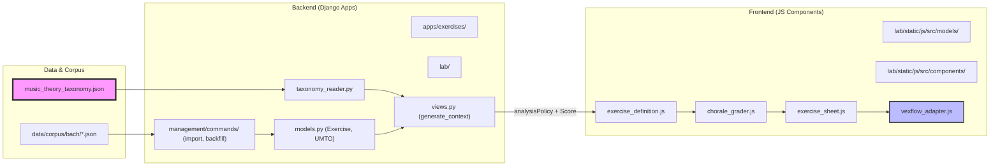
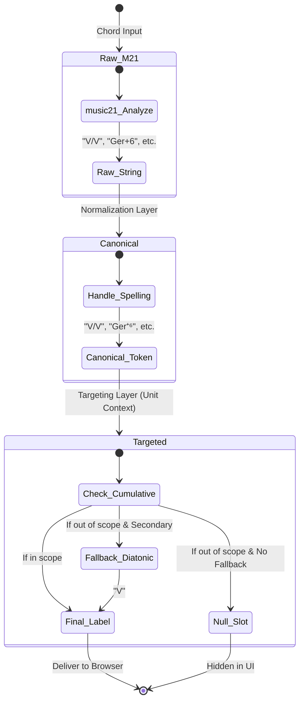

# Taxonomy as Source of Truth - Visual Plan

This document visualizes the architectural shift from hardcoded, fragmented curriculum logic to a centralized, taxonomy-driven system for HarmonyLab.

## 1. Architectural Shift: Before vs. After

### Current State (Fragmented)
Logic is duplicated across multiple files. Changes in one place often lead to desynchronization.

### Proposed State (Unified)
A single JSON file drives behavior for both the server and the browser.

---

## 2. The Analysis Pipeline: Three Distinct Steps

This is the core logic that converts music into a student-facing exercise.

---

## 3. Data Flow: Database to Browser

The database no longer stores the *curriculum-specific* answer, only the *musical* record.

---

## 4. Exercise Mode Landscape

This table clarifies how different exercise modes interact with the system and which are covered by the current **Taxonomy as Source of Truth** spec.

| Mode | Interaction | Analysis Engine / Logic | Spec Status |
| :--- | :--- | :--- | :--- |
| **`play`** | Student plays MIDI | `chorale_grader.js` (Window Matching) | **Out of Scope** (Separate Pipeline) |
| **`roman`** | Student clicks labels | **Server-stored `roman_numeral`** | **IN SCOPE (Primary Focus)** |
| **`figures`**| Student clicks labels | Server-stored `figured_bass` | **Deferred** (Same Pattern) |
| **`matching`**| Plays notes to match label | `ANALYSIS_MATCH` mode | **Out of Scope** |

### Key Distinction: Bach vs. Legacy
*   **UMTO Chorale/Identification:** The "New World" (Play, Roman, Figures). Driven by CIR scores and the unified taxonomy.
*   **Legacy Exercises:** (`analyze.js`, `exercise_grader.js`, chord labels, set-class). A completely separate world for old harmonization/analysis exercises; **not used for Bach chorale playlists.**

---

## 5. Repository Architecture Map

This map visualizes how the core modules of HarmonyLab interact, highlighting the path from the **Taxonomy** to the **Browser**.

---

## 6. Harmonic Analysis State Machine

Emulating an **XState**-style statechart, this diagram shows the lifecycle of a harmonic label as it moves through the pipeline.

---

## 7. Key File Transformations

| Layer | File | Role Change |
| :--- | :--- | :--- |
| **Data** | `music_theory_taxonomy_with_branches.json` | **Becomes Authority.** Adds `analysis.roman` (cumulative/new lists). |
| **Logic** | `apps/exercises/taxonomy_reader.py` | **Gatekeeper.** New methods: `get_unit_analysis()`, `get_cumulative_values()`. |
| **Pipeline**| `import_bach_phrases.py` | **Recorder.** Stores `raw_roman_numeral`. Hardcoded dict deleted. |
| **Delivery**| `lab/views.py` | **Translator.** Builds `analysisPolicy` and resolves targeting at request time. |
| **Frontend**| `exercise_definition.js` | **Consumer.** Deletes hardcoded dict. UI driven by `analysisPolicy`. |

---

## 8. Implementation Checklist

- [ ] **Step 1: Data Authoring** - Populate `analysis` objects in taxonomy JSON files.
- [ ] **Step 2: API Extension** - Update `TaxonomyReader` with new getter methods.
- [ ] **Step 3: Storage Backfill** - Run `backfill_raw_roman_numeral` to populate raw data in existing UMTO exercises.
- [ ] **Step 4: Request-Time Resolution** - Implement targeting logic in `lab/views.py`.
- [ ] **Step 5: Frontend Decoupling** - Remove hardcoded tables in `exercise_definition.js` and sync with new payload.
- [ ] **Step 6: Playlist Integration** - Update `create_unit_playlist.py` to use the unified targeting logic.
